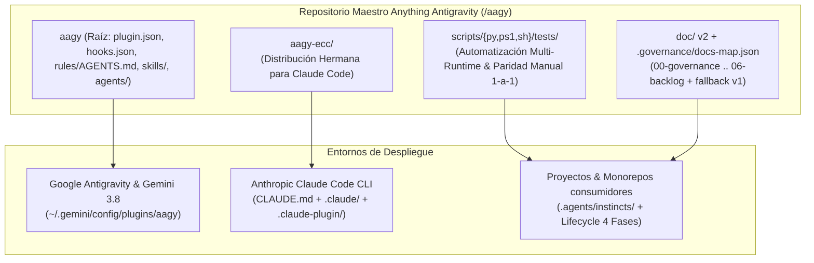

# Anything Antigravity (`aagy`)

> **Ecosistema Maestro Multi-Harness para Google Antigravity, Gemini 3.8 y Anthropic Claude Code (`aagy-ecc`)**  
> Repositorio Canónico: [`ACB75/aagy`](https://github.com/ACB75/aagy) | Versión: `5.1.1`

---

## 1. Visión y Arquitectura

**Anything Antigravity (`aagy`)** es el arnés de ingeniería de software, gobernanza autónoma y optimización de presupuesto de contexto diseñado para **Google Antigravity & Gemini 3.8** con paridad simétrica hacia **Anthropic Claude Code (`aagy-ecc/`)**:



---

## 2. Arquitectura Two-Tier y Distribuciones

| Distribución | Destino | Características Clave | Presupuesto en Reposo |
| :--- | :--- | :--- | :--- |
| **`aagy` (Raíz)** | Google Antigravity & Gemini (`~/.gemini/config/plugins/aagy`) | **Tier 1 Global**: [`rules/AGENTS.md`](rules/AGENTS.md), perfil `generic` (17 skills y 12 subagentes) y [`hooks.json`](hooks.json) (`SessionStart`, `PreToolUse`, `PostToolUse`, `Stop`). **Tier 2**: 168 skills y 47 subagentes en total, instalados por perfil de stack. | Descripciones ≤ 200 caracteres; topes comprobados en CI ([`MANUAL_scripts_and_token_optimization.md`](doc/04-operations/runbooks/MANUAL_scripts_and_token_optimization.md)). |
| **[`aagy-ecc`](aagy-ecc/README.md)** | Anthropic Claude Code (`aagy-ecc/`) | Plugin hermano con espejo generado de `skills/`, `agents/` y `rules/AGENTS.md` ([`sync_aagy_ecc.py`](scripts/py/sync_aagy_ecc.py)), hooks propios de Claude Code (`SessionStart` reglas, `PreToolUse` safety gate, `PostToolUse` markdownlint, `Stop` self-improve), `commands/` y [`project-template/`](aagy-ecc/project-template/CLAUDE.md); deriva bloqueada por [`audit_plugin_parity.py`](scripts/py/audit_plugin_parity.py). | Paridad 100% con `aagy`. |

---

## 3. Instalación y Sincronización (`install.ps1` / `install.sh`)

### Windows 11 (PowerShell 7+)

```powershell
# 1. Instalar / actualizar el plugin global aagy en Google Antigravity (Tier 1 recomendado)
pwsh -NoProfile -File install.ps1 -Target agy -Profile minimal

# 2. Instalar el catálogo completo de skills en Antigravity
pwsh -NoProfile -File install.ps1 -Target agy -Profile full

# 3. Sincronizar e instalar la distribución hermana aagy-ecc como plugin de Claude Code
#    (-Destination opcional: copia además la plantilla CLAUDE.md + .claude/ al proyecto)
pwsh -NoProfile -File install.ps1 -Target aagy-ecc -Destination C:\Ruta\A\MiProyecto

# 4. Instalar en un repo consumidor los perfiles de stack que declara en .governance/aagy-profiles.json
#    (network-infra, java-spring, angular, go, python; ADR-0004)
pwsh -NoProfile -File scripts/ps1/aagy-sync.ps1 -Repo C:\Ruta\A\MiRepo
```

### Linux / WSL / macOS (POSIX LF `\n`)

```bash
# 1. Instalar plugin global aagy (Tier 1)
./install.sh agy

# 2. Sincronizar e instalar aagy-ecc (Claude Code); el destino opcional recibe la plantilla de proyecto
./install.sh aagy-ecc /ruta/a/mi-proyecto

# 3. Instalar en un repo consumidor sus perfiles de stack (ADR-0004)
bash scripts/sh/aagy-sync.sh --repo /ruta/a/mi-repo
```

---

## 4. Estructura Consolidada de Scripts (`scripts/{py,ps1,sh}/tests/`)

Toda la automatización del ecosistema reside en tres motores multi-runtime con suites `pytest` dedicadas (`154/154` tests) y **paridad manual 1-a-1** (cualquier flujo es ejecutable desde terminal sin depender del plugin):

- **[`scripts/py/`](scripts/py/)**: Motores Python 3 stdlib pura (`docs_map.py`, `new_lifecycle_task.py`, `self_improve.py`, `instinct_manager.py`, `workspace_audit.py`, `sonar_audit.py`, `security_audit.py`, `audit_plugin_parity.py`, `map_docs.py`, `archive_todo.py`, `sync_ideas_todo.py`, `format_commit.py`, `validate_branch.py`, `generate_postmortem.py`) y pruebas en `scripts/py/tests/`.
- **[`scripts/ps1/`](scripts/ps1/)**: Wrappers nativos para Windows PowerShell 7 (`aagy complete-task-pr`, `aagy new-lifecycle-task`, `aagy workspace-audit`, `aagy self-improve`, `aagy-sync.ps1`, `lint-markdown.ps1`, `aagy map-docs`, etc.) y pruebas en `scripts/ps1/tests/`.
- **[`scripts/sh/`](scripts/sh/)**: Wrappers POSIX con finales de línea `LF (\n)` estrictos para Linux/WSL y pruebas en `scripts/sh/tests/`.

### Comandos Frecuentes de Verificación y Ciclo de Vida

```powershell
# Ejecutar suite completa de tests multi-runtime (Python, PowerShell y Shell)
python -m pytest scripts/py/tests scripts/ps1/tests scripts/sh/tests -q

# Auditoría integral de higiene, presupuesto de tokens, SonarQube Rating A y AgentShield
pwsh -NoProfile -File scripts/ps1/aagy.ps1 workspace-audit --clean

# Auditoría de paridad multi-harness (aagy <-> aagy-ecc)
pwsh -NoProfile -File scripts/ps1/aagy.ps1 audit-plugin-parity

# Diagnóstico de la instalación (mismos checks DOC-01..17 en los dos harnesses; -Fix con confirmación)
pwsh -NoProfile -File scripts/ps1/aagy.ps1 aagy-doctor        # Antigravity / Gemini
pwsh -NoProfile -File scripts/ps1/aagy.ps1 aagy-ecc-doctor    # Claude Code (o /aagy-ecc-doctor en la sesión)

# Validación de enlaces relativos y contrato .governance/docs-map.json
pwsh -NoProfile -File scripts/ps1/aagy.ps1 map-docs

# Linter de Markdown (DavidAnson markdownlint)
pwsh -NoProfile -File scripts/ps1/lint-markdown.ps1 -CheckOnly

# Motor unificado de autodescubrimiento, instintos a doble nivel y automejora con budget gate
pwsh -NoProfile -File scripts/ps1/aagy.ps1 self-improve --discover --scope all
```

---

## 5. Arquitectura Documental `/doc` v2 y Gobernanza

La documentación sigue el estándar **`/doc` v2** gobernado por [`.governance/docs-map.json`](.governance/docs-map.json) (con *fallback* retrocompatible automático para proyectos con la estructura clásica v1):

- 📑 **[`doc/INDEX.md`](doc/INDEX.md)**: Índice maestro navegable de toda la documentación.
- 🧭 **[`doc/CONTEXT.md`](doc/CONTEXT.md)**: Vocabulario canónico y fronteras del ecosistema `aagy` / `aagy-ecc`.
- 🚦 **[`doc/STATUS.md`](doc/STATUS.md)**: Estado operativo actual, métricas de presupuesto de tokens y SonarQube Quality Gate `A`.
- 📜 **[`doc/LOG.md`](doc/LOG.md)**: Registro histórico *append-only* de hitos y decisiones arquitectónicas.
- 📏 **[`doc/00-governance/DOC_STANDARDS.md`](doc/00-governance/DOC_STANDARDS.md)**: Norma `/doc` v2, convención `<folder>/dgrms/` (`.mmd`, `.puml`, `.bpmn`) y reglas `markdownlint`.
- 🛠️ **[`doc/00-governance/MANUAL_WORKFLOW.md`](doc/00-governance/MANUAL_WORKFLOW.md)**: Guía de paridad manual 1-a-1 CLI $\leftrightarrow$ Plugin y puntos de entrada flexibles (`IDEAS` $\rightarrow$ `REQ` $\rightarrow$ `PLAN` $\rightarrow$ `TODO`).
- 🏗️ **[`doc/01-architecture/`](doc/01-architecture/GUIA_ARQUITECTURA_HARNESS_Y_ENTORNO_AGY.md)**: Arquitectura del harness Antigravity y manual de paridad [`MANUAL_aagy_ecc_parity_and_migration.md`](doc/01-architecture/MANUAL_aagy_ecc_parity_and_migration.md).
- 🏛️ **[`doc/02-adr/README.md`](doc/02-adr/README.md)**: Índice de Architecture Decision Records (`ADR-0001`..`ADR-0003`).
- 🔄 **[`doc/03-domain-and-flows/`](doc/03-domain-and-flows/)**: Flujos de dominio y diagramas PlantUML / BPMN2.
- ⚙️ **[`doc/04-operations/`](doc/04-operations/runbooks/MANUAL_unified_self_improvement.md)**: Runbooks operativos y guías de configuración.
- 🩺 **[`doc/05-post-mortems/`](doc/05-post-mortems/PM_fix_scripts_install_dir_creation_20261120_203232.md)**: Autopsias SRE 5-Whys (*blameless*).
- 📋 **[`doc/06-backlog/TODO.md`](doc/06-backlog/TODO.md)**: Backlog activo, [`IDEAS.md`](doc/06-backlog/IDEAS.md), planes `REQ_*.md` y archivo histórico `doc/06-backlog/done/`.
