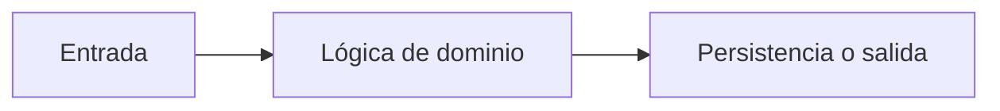

# Fase 2: Plan de acción, diseño y TDD

> **ID de Tarea**: `<id_tarea>`
> **Fecha**: `YYYY-MM-DD` | **Autor/Rol**: `<autor / rol>`
> **Estado**: `BORRADOR | LISTO PARA EJECUCIÓN`
> **Ubicación en el repo**: `<carpeta de planes>/PLAN_<id_tarea>.md` (requisitos en `REQ_<id_tarea>.md`)

---

## 0. Estado actual

Qué se reutiliza (módulos, utilidades, esquemas) y qué falta. Nada nuevo si ya existe algo equivalente.

## 1. Contexto y objetivos

- **Problema**: resumen del REQ.
- **Objetivo**: resultado observable en una o dos líneas.
- **Alcance**: qué entra.
- **Fuera de alcance**: qué no entra.

## 2. Diseño

- **Patrones**: los que se aplican y por qué.
- **Tipado e inmutabilidad**: estructuras inmutables y sin tipos abiertos (`any`).

## 3. Pasos (TDD)

- [ ] **RED**: tests que fallan y cubren los RF, los CA y los casos límite.
- [ ] **GREEN**: la solución mínima que los pasa.
- [ ] **REFACTOR**: complejidad ≤ 15, sin literales repetidos, funciones pequeñas.
- [ ] **VERIFY**: tests, linters, auditoría de seguridad y CI local en verde.

## 4. Decisiones y costes

| Decisión | Alternativa descartada | Coste visible | Coste oculto |
| :--- | :--- | :--- | :--- |
| `<decisión>` | `<alternativa>` | `<tiempo, CPU, RAM>` | `<mantenimiento, acoplamiento>` |

## 5. Riesgos y rollback

- **Riesgo**: `<escenario>`. **Mitigación**: `<contramedida>`.
- **Rollback**: `git revert <sha-del-squash>` y, si hay datos, la migración inversa probada.

<!-- aagy-extensions -->

## 6. Criterios de aceptación

- [ ] **CA-01**: los CA del REQ tienen un test que los cubre.

## 7. Paridad aagy ↔ aagy-ecc

Qué ficheros se espejan (`sync_aagy_ecc.py`) y qué asimetrías hay.

## 8. Preguntas abiertas

- **P-01**: `<pregunta>`. Por defecto: `<valor>`.

## 9. Referencias

- `REQ_<id_tarea>.md`, `<rutas, ADR, issues>`
