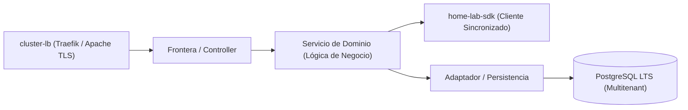

# Fase 2: Plan de Acción, Diseño Arquitectónico y Estrategia TDD

> **Referencia de Requisitos**: [`doc/plan/REQ_<id_tarea>.md`](REQ_<id_tarea>.md)  
> **ID de Tarea**: `<tipo>/<proyecto>/<id>`  
> **Fecha**: `YYYY-MM-DD` | **Estado**: `LISTO PARA EJECUCIÓN`  

---

## 1. Inventario de Reutilización y Prevención de Duplicados (DRY First)

> *Prohibido escribir código net-new si existen módulos, utilidades, esquemas o DTOs equivalentes en el workspace.*

- **Módulos y Servicios Reutilizados**:
  - `[RutaArchivo](file:///...)`: Qué método, clase o componente existente se consume y cómo evita duplicación.
- **Validación de Dependencias**:
  - Confirmación de uso exclusivo de APIs nativas del lenguaje/framework y paquetes oficiales ya instalados.
  - Cero dependencias no autorizadas de terceros.

---

## 2. Diseño Arquitectónico y Topología Home-Lab

- **Patrones de Diseño Aplicados**: (ej. *Strategy*, *Repository*, *Builder inmutable*, *Signals OnPush*, *Clean Architecture*).
- **Tipado Estricto e Inmutabilidad**: Uso de `record` (Java), `@dataclass(frozen=True)` (Python) o `readonly` (TypeScript). Prohibido `any`.

---

## 3. Estrategia de Paridad y Sincronización `home-lab-sdk`

*Completar si en la Fase 1 se identificó impacto en contratos o APIs compartidas:*

- [ ] **Paso SDK 1**: Actualizar interfaces, modelos y DTOs en `home-lab-sdk/`.
- [ ] **Paso SDK 2**: Actualizar clientes políglotas (Java, Go, Python o TypeScript).
- [ ] **Paso SDK 3**: Ejecutar suite de pruebas unitarias de `home-lab-sdk/` y verificar exit code 0.

---

## 4. Plan de Acción Paso a Paso (TDD: RED -> GREEN -> REFACTOR)

### 4.1. Fase 1: Tests Primero (`RED`)

- [ ] Escribir tests unitarios y de integración que fallen inicialmente, cubriendo los requisitos funcionales (`RF`), criterios de aceptación (`CA`) y casos límite.
- Archivos de prueba: `[test_modulo.py](file:///...)` / `[ModuloTest.java](file:///...)`.

### 4.2. Fase 2: Implementación Mínima Segura (`GREEN`)

- [ ] Desarrollar la solución mínima y limpia para pasar los tests sin sobreingeniería (KISS/YAGNI).
- [ ] Configurar límites de recursos (`GOMEMLIMIT=80%` en Go, heap porcentual en JVM).
- Archivos de implementación: `[modulo.py](file:///...)` / `[Modulo.java](file:///...)`.

### 4.3. Fase 3: Refactorización y Clean Code (`REFACTOR`)

- [ ] Reducir la Complejidad Cognitiva ($\le 15$ según regla `S3776`).
- [ ] Eliminar literales duplicados $\ge 3$ veces (`S1192`).
- [ ] Asegurar funciones pequeñas con responsabilidad única (SRP) y *early returns* ($< 4$ niveles de anidamiento).
- [ ] Confirmar que el 100% de los tests se mantengan en verde.

### 4.4. Fase 4: Bucle de Verificación Pre-Merge (`VERIFY`)

- [ ] Compilación y tipado estricto sin advertencias (`build` / `tsc`).
- [ ] Linter y formato de código (`lint-markdown.ps1 -CheckOnly`).
- [ ] Suite completa de tests pasando con cobertura $\ge 80\%$.
- [ ] SonarQube Quality Gate Rating A alcanzado (0 violaciones).
- [ ] Auditoría de seguridad estática: 0 secretos, 0 vulnerabilidades.

---

## 5. Análisis de Costes de la Decisión Arquitectónica

| Decisión Técnica Adoptada | Alternativa Descartada | Coste Visible (Inmediato / CPU / RAM / DDL) | Coste Oculto (Mantenibilidad / Deuda Técnica) |
| :--- | :--- | :--- | :--- |
| **Decisión 1**: `<Descripción>` | `<Alternativa>` | Tiempo de desarrollo, uso de CPU/RAM, cambios de esquema | Curva de aprendizaje, acoplamiento, mantenimiento de tests |

---

## 6. Mitigación de Riesgos y Plan de Fast-Rollback (< 2 Minutos)

- **Riesgo 1**: `<Escenario adverso o potencial degradación>` -> **Mitigación**: `<Contramedida preventiva>`.
- **Estrategia de Rollback Atómico**:
  - En caso de anomalía en CI o entorno de despliegue: `git revert <sha-del-squash-commit>`.
- **Reversión de Persistencia (Base de Datos)**:
  - Script de reversión probado: `[down-migration.sql](file:///...)`.
