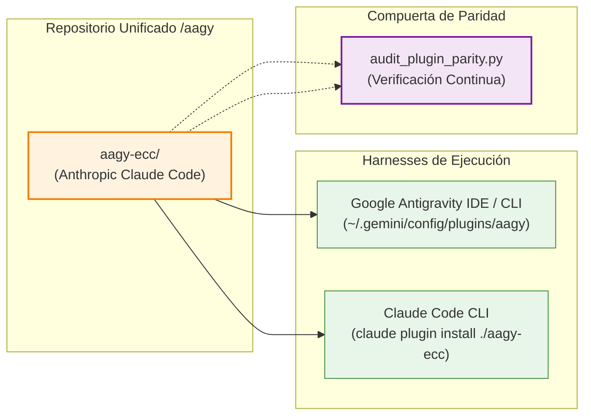

# Manual de Arquitectura y Paridad Multi-Harness: Anything Antigravity (`aagy`) y Claude Code (`aagy-ecc`)

> **Referencia Canónica**: `doc/01-architecture/MANUAL_aagy_ecc_parity_and_migration.md`  
> **Ámbito**: Orquestación y Gobernanza Dual `aagy` (Google Antigravity & Gemini) $\leftrightarrow$ `aagy-ecc` (Anthropic Claude Code)  

---

## 1. Visión General y Propósito

El ecosistema **Anything Antigravity (`aagy`)** implementa una arquitectura desacoplada y simétrica para soportar dos harnesses de inteligencia artificial líderes en la industria:

1. **`aagy` (Raíz del Repositorio)**:
   - Diseñado específicamente para **Google Antigravity** y **Gemini CLI**.
   - Integra catálogo de habilidades en dos niveles (Two-Tier Architecture), agentes canónicos (`argon`, `hydrogen`, `carbon`, `neon`), compuertas de calidad SonarQube Rating A y telemetría de tokens.
2. **`aagy-ecc` (`aagy-ecc/`)**:
   - Subplugin dedicado para **Anthropic Claude Code**.
   - Provee artefactos nativos como `CLAUDE.md`, `.claude/commands/`, hooks bash/python de ciclo de vida y configuración de plugins Claude.



---

## 2. Invocación de la Auditoría de Paridad

Para verificar que no exista deriva ni discrepancias entre ambos plugins:

```powershell
# En Windows 11 con PowerShell 7
pwsh -File scripts/ps1/audit-plugin-parity.ps1

# Solo verificación (retorna código 0 o 1)
pwsh -File scripts/ps1/audit-plugin-parity.ps1 -CheckOnly

# Salida estructurada JSON para pipelines CI/CD
pwsh -File scripts/ps1/audit-plugin-parity.ps1 -Json
```

En entornos Linux / WSL (POSIX LF):

```bash
bash scripts/sh/audit-plugin-parity.sh --check-only
```

---

## 3. Instalación y Despliegue

```powershell
# Instalar / sincronizar plugin para Google Antigravity (aagy)
pwsh -File install.ps1 -Target agy -Profile minimal

# Sincronizar el espejo e instalar aagy-ecc como plugin de Claude Code
pwsh -File install.ps1 -Target aagy-ecc

# Además, copiar la plantilla CLAUDE.md + .claude/ en un proyecto
pwsh -File install.ps1 -Target aagy-ecc -Destination C:\Ruta\A\Proyecto
```

### 3.1. Qué verifica la auditoría de paridad

[`audit_plugin_parity.py`](../../scripts/py/audit_plugin_parity.py) falla (`exit 1`) si:

- `aagy-ecc/skills/`, `aagy-ecc/agents/`, `aagy-ecc/rules/AGENTS.md` o `aagy-ecc/scripts/py/` difieren de la raíz (comparación por contenido vía [`sync_aagy_ecc.py`](../../scripts/py/sync_aagy_ecc.py)).
- Algún script referenciado con `${CLAUDE_PLUGIN_ROOT}` en `aagy-ecc/hooks/hooks.json` no existe dentro del plugin.
- El nombre o la versión de `aagy-ecc/.claude-plugin/plugin.json` no coinciden con `aagy-ecc` y con la versión de `plugin.json` raíz, o `marketplace.json` no publica `aagy-ecc`.

Tras editar skills, agentes, reglas o motores Python en la raíz:

```powershell
pwsh -File scripts/ps1/sync-aagy-ecc.ps1
```

---

## 4. Paridad de hooks y asimetrías

Los dos plugins usan los mismos motores Python (`scripts/py/hook_safety.py`, `hook_post_write.py`,
`agent_worktree.py guard`, `local_private_guard.py`, `self_improve.py`, `backlog.py`) con
`--format claude` o `--format agy`. Los envoltorios `safety-check` y `hook-post-write` (`.ps1`/`.sh`)
solo llaman al motor. En `aagy`, `hooks.json` usa `${AAGY_PLUGIN_ROOT}` y el instalador lo sustituye por
la carpeta del plugin, como `${CLAUDE_PLUGIN_ROOT}` en `aagy-ecc`.

Antigravity no tiene los eventos `SessionStart`, `PreCompact`, `SessionEnd` ni `Notification`. Así se cubren:

| Momento | Claude Code | Antigravity |
| :--- | :--- | :--- |
| Inicio (reglas, resumen del backlog, reciclado del worktree) | `SessionStart` | Lee `AGENTS.md` de forma nativa; recicla en `backlog.py claim` y en `complete_task_pr.py --merge` |
| Compactación | `PreCompact` (`checkpoint`) | `checkpoint` en cada `Stop` |
| Fin de sesión | `SessionEnd` (`handoff`) | `checkpoint` en cada `Stop` y caducidad del claim (`AAGY_BACKLOG_TTL_HOURS`) |
| Pregunta antes de leer un fichero privado | `ask` | Solo admite `allow` o `deny`: deniega y propone `local_run` |
| Aviso de escritorio al pedir permiso | `Notification` (`aagy_notify.py`) | Sin evento: solo avisa en `Stop` (ver `MANUAL_ui.md`) |

`audit_plugin_parity.py` falla si un evento compartido usa motores distintos o si aparece una asimetría
no declarada (`HOOK_ASYMMETRY_EVENTS`).
