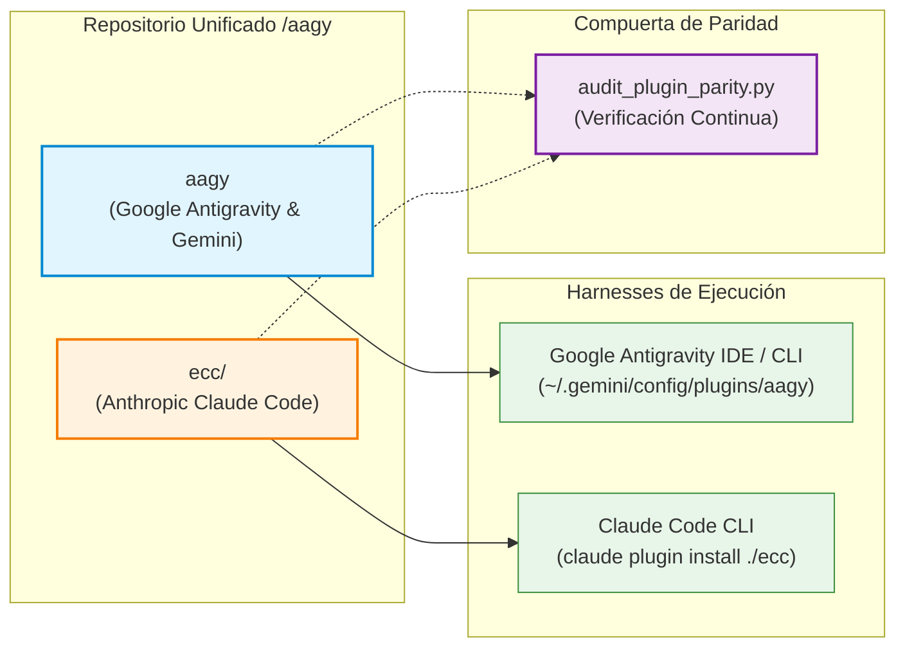

# Manual de Arquitectura y Paridad Multi-Harness: Anything Antigravity (`aagy`) y Claude Code (`ecc`)

> **Referencia Canónica**: `doc/manual/MANUAL_aagy_ecc_parity_and_migration.md`  
> **Ámbito**: Orquestación y Gobernanza Dual `aagy` (Google Antigravity & Gemini) $\leftrightarrow$ `ecc` (Anthropic Claude Code)  

---

## 1. Visión General y Propósito

El ecosistema **Anything Antigravity (`aagy`)** implementa una arquitectura desacoplada y simétrica para soportar dos harnesses de inteligencia artificial líderes en la industria:

1. **`aagy` (Raíz del Repositorio)**:
   - Diseñado específicamente para **Google Antigravity** y **Gemini CLI**.
   - Integra catálogo de habilidades en dos niveles (Two-Tier Architecture), agentes canónicos (`argon`, `hydrogen`, `carbon`, `neon`), compuertas de calidad SonarQube Rating A y telemetría de tokens.
2. **`ecc` (`aagy/ecc/`)**:
   - Subplugin dedicado para **Anthropic Claude Code**.
   - Provee artefactos nativos como `CLAUDE.md`, `.claude/commands/`, hooks bash/python de ciclo de vida y configuración de plugins Claude.



---

## 2. Invocación de la Auditoría de Paridad

Para verificar que no exista deriva ni discrepancias entre ambos plugins:

```powershell
# En Windows 11 con PowerShell 7
pwsh -File scripts/bin/ecc-agy/audit-plugin-parity.ps1

# Solo verificación (retorna código 0 o 1)
pwsh -File scripts/bin/ecc-agy/audit-plugin-parity.ps1 -CheckOnly

# Salida estructurada JSON para pipelines CI/CD
pwsh -File scripts/bin/ecc-agy/audit-plugin-parity.ps1 -Json
```

En entornos Linux / WSL (POSIX LF):

```bash
bash scripts/bin/ecc-agy/audit-plugin-parity.sh --check-only
```

---

## 3. Instalación y Despliegue

```powershell
# Instalar / sincronizar plugin para Google Antigravity (aagy)
pwsh -File install.ps1 -Target agy -Profile minimal

# Desplegar boilerplates para Claude Code (ecc) en un proyecto
pwsh -File install.ps1 -Target claude -Destination C:\Ruta\A\Proyecto
```
