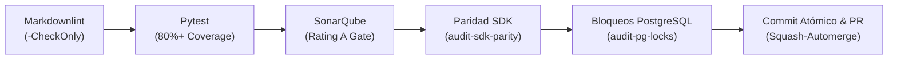

# Manual de Operación: Analizador de Bloqueos DDL en PostgreSQL LTS (`audit_pg_locks.py`)

> **Ecosistema**: AAGY Ecosystem & Home-Lab  
> **Ubicación Canónica**: `scripts/py/audit_pg_locks.py`  
> **Wrappers CLI**: `scripts/ps1/audit-pg-locks.ps1` y `audit-pg-locks.sh`  
> **Compuerta CI/CD**: Fase 4 del Engineering Lifecycle (`complete-task-pr.ps1`)  

---

## 1. Propósito y Filosofía Arquitectónica

Home-Lab consolida todos los microservicios en una instancia única y endurecida de PostgreSQL LTS (Pilar 3: *Centralized Multi-Database Persistence*). En este entorno multitenant compartido, un bloqueo pesado `ACCESS EXCLUSIVE` provocado por una migración bloquea de inmediato todas las consultas concurrentes (`SELECT`, `INSERT`, `UPDATE`, `DELETE`) en la tabla afectada. Esto genera una cascada de conexiones encoladas que satura el pool de conexiones (`pgbouncer` / motor) e interrumpe múltiples microservicios a la vez.

El **Analizador Estático de Bloqueos DDL** escanea de forma proactiva y determinista los archivos SQL (`*.sql`), categoriza las operaciones según el tipo de bloqueo que adquieren y orienta al desarrollador con las mejores prácticas de concurrencia sin tiempo de inactividad (*zero-downtime migrations*).

---

## 2. Catálogo de Riesgos y Alternativas Seguras

### Nivel ROJO (`HIGH` - Bloqueo Crítico o Table Rewrite)

Adquieren `ACCESS EXCLUSIVE` y bloquean todas las lecturas y escrituras:

1. **`DROP TABLE` / `TRUNCATE`**:
   - *Impacto*: Congela la tabla y elimina datos.
   - *Remediación*: Archivar o renombrar temporalmente antes de la eliminación definitiva.
2. **`ALTER TABLE ... DROP COLUMN`**:
   - *Impacto*: Bloquea transacciones concurrentes.
   - *Remediación*: Ignorar la columna en la capa de aplicación antes de programar su retirada en ventana de mantenimiento.
3. **`ALTER TABLE ... ALTER COLUMN ... TYPE`**:
   - *Impacto*: Provoca la reescritura de toda la tabla en disco.
   - *Remediación*: Añadir columna nueva, activar *dual-write*, sincronizar datos en lotes pequeños y finalmente conmutar.
4. **`ALTER TABLE ... ADD CONSTRAINT ... FOREIGN KEY / CHECK` (sin `NOT VALID`)**:
   - *Impacto*: Adquiere `ACCESS EXCLUSIVE` mientras valida todas las filas existentes.
   - *Remediación*: Crear la constraint con `NOT VALID` (bloqueo sub-milisegundo) y validar posteriormente con `ALTER TABLE ... VALIDATE CONSTRAINT` en una transacción separada.
5. **`ALTER TABLE ... ADD COLUMN ... DEFAULT <volatil>`**:
   - *Impacto*: Expresiones como `now()`, `random()`, o `gen_random_uuid()` fuerzan reescritura de tuplas.
   - *Remediación*: Añadir columna nullable, poblar en lotes y establecer el default para filas futuras.
6. **`VACUUM FULL`**:
   - *Impacto*: Bloquea la tabla por completo.
   - *Remediación*: Usar `pg_repack` o afinar parámetros de `autovacuum`.

### Nivel AMARILLO (`MEDIUM` - Bloqueo de Escrituras)

Adquieren `SHARE` o bloqueos exclusivos de índice:

1. **`CREATE INDEX` (sin `CONCURRENTLY`)**:
   - *Impacto*: Permite lecturas pero bloquea `INSERT`, `UPDATE` y `DELETE`.
   - *Remediación*: Usar siempre `CREATE INDEX CONCURRENTLY` fuera de bloques de transacción.
2. **`DROP INDEX` (sin `CONCURRENTLY`)**:
   - *Impacto*: Bloquea consultas durante la eliminación.
   - *Remediación*: Usar `DROP INDEX CONCURRENTLY`.

### Nivel VERDE (`LOW` / `PASS` - Seguro en Producción)

- `CREATE INDEX CONCURRENTLY`
- `DROP INDEX CONCURRENTLY`
- `ALTER TABLE ... ADD COLUMN` (nullable o con default constante en PG 11+)
- `ALTER TABLE ... ADD CONSTRAINT ... NOT VALID`
- `ALTER TABLE ... VALIDATE CONSTRAINT`
- `CREATE TABLE`, `CREATE SCHEMA`, `CREATE VIEW`

---

## 3. Comandos y Sintaxis CLI

### PowerShell (Windows 11)

```powershell
# Escanear el repositorio (ignora automáticamente .git, node_modules y skills)
pwsh -File scripts/ps1/audit-pg-locks.ps1

# Auditar un archivo de migración específico
pwsh -File scripts/ps1/audit-pg-locks.ps1 -File "services/kakebo/migrations/003_add_index.sql"

# Auditar un directorio de migraciones
pwsh -File scripts/ps1/audit-pg-locks.ps1 -Dir "services/kakebo/migrations"

# Salida estructurada JSON
pwsh -File scripts/ps1/audit-pg-locks.ps1 -Json

# Modo permisivo (no retornar error 1 ante riesgos MEDIUM)
pwsh -File scripts/ps1/audit-pg-locks.ps1 -NoStrict
```

### Bash / Linux (WSL / Debian 12)

```bash
# Ejecución estándar
scripts/sh/audit-pg-locks.sh

# Auditar archivo específico con salida JSON
scripts/sh/audit-pg-locks.sh --file services/whoiam/migrations/001_init.sql --json
```

---

## 4. Integración en el Pipeline de Calidad (`complete-task-pr.ps1`)

`complete-task-pr.ps1` ejecuta automáticamente el analizador de bloqueos en el paso 7.4 antes de comprometer cambios y crear la Pull Request:


