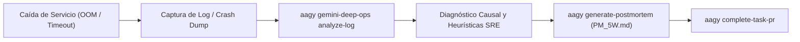

# Manual de Operaciones: Diagnóstico Multimodal y Deep Ops con Gemini

> **Referencia Operacional**: Integración Zero-Overhead de `gemini-mcp` y Skill `gemini-deep-ops`  
> **Fecha**: `2026-11-20` | **Autor**: `Carbon (C6) / Gemini Platform Architect`  

---

## 1. Filosofía de Diseño: Zero-Overhead en Reposo

El ecosistema proyecto consumidor y Antigravity prioriza la economía estricta de tokens en cada turno conversacional. El servidor `gemini-mcp` (RLabs-Inc) contiene más de 30 herramientas especializadas que, si se cargaran permanentemente en el arnés global, consumirían de 4.500 a 10.000 tokens en reposo.

Para combinar la máxima potencia analítica con coste cero en reposo, se implementa una arquitectura en tres capas:

1. **Plantilla Aislada (`skills/gemini-deep-ops/templates/gemini-mcp/`)**: Contiene `"disabled": true` por defecto y referencias seguras `${GEMINI_API_KEY}`.
2. **Utilidad de Alternancia (`aagy toggle-gemini-mcp`)**: Permite conmutar el estado del plugin en segundos para sesiones específicas.
3. **Skill Tier 2 y CLI Nativo (`aagy gemini-deep-ops`)**: Provee capacidades diagnósticas sobre logs masivos y volcados de memoria sin requerir la inyección de esquemas MCP en el contexto del modelo.

---

## 2. Diagnóstico Multimodal en Incidentes SRE y Post-Mortems 5W

Cuando un servicio del clúster experimenta una degradación crítica (ej. `OOMKilled` código 137, bloqueos DDL en PostgreSQL LTS o timeouts en Traefik), el flujo operativo en la rama `fix/*` es:



### Ejemplo de Diagnóstico de Crash Dump

```powershell
pwsh -File scripts/ps1/aagy.ps1 gemini-deep-ops analyze-log --file /var/log/cluster/service.log
```

Salida estructurada:

```text
=== REPORTE DE ANÁLISIS DE LOGS ===
Estado:        ÉXITO
Severidad:     CRITICAL
Diagnóstico:   Detección de fallo por agotamiento de memoria (OOM / Error 137).
Recomendaciones SRE:
  • Ajustar GOMEMLIMIT=80% en servicios Go o -XX:MaxRAMPercentage=75 en JVM.
  • Revisar límites de memoria en docker-compose y verificar fugas en buffers de streaming.
```

---

## 3. Integración con Post-Mortem 5W

Al ejecutar `aagy generate-postmortem` en cualquier rama `fix/*`, la sección diagnóstica de `gemini-deep-ops` puede insertarse automáticamente mediante:

```powershell
pwsh -File scripts/ps1/aagy.ps1 gemini-deep-ops postmortem --issue fix/cluster/oom-timeout --file path/to/crash.log >> doc/post-mortem/PM_fix_cluster_oom_timeout.md
```
