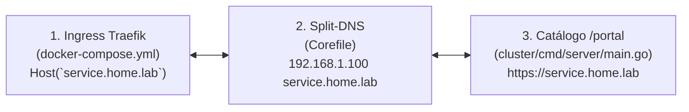
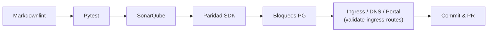

# Manual de Operación: Validador de Congruencia Ingress, Split-DNS y Portal (`validate_ingress_routes.py`)

> **Ecosistema**: AAGY Ecosystem & Home-Lab  
> **Ubicación Canónica**: `scripts/py/validate_ingress_routes.py`  
> **Wrappers CLI**: `scripts/pwsh/validate-ingress-routes.ps1` y `validate-ingress-routes.sh`  
> **Compuerta CI/CD**: Fase 4 del Engineering Lifecycle (`complete-task-pr.ps1`)  

---

## 1. Propósito y Filosofía Arquitectónica

Home-Lab sigue estrictamente el Pilar 2 de Ingeniería de Google ("Single Ingress & Unified TLS"): ningún microservicio expone puertos crudos externamente. Todo el tráfico HTTP/HTTPS ingresa a través del reverse proxy Traefik (`cluster-lb`).

Para que un microservicio funcione y sea navegable dentro de la red privada `home.lab`, se requiere una sincronización trilateral:



Si un host se define en Traefik pero no se añade a CoreDNS, los clientes reciben errores de resolución DNS (`NXDOMAIN`). Si se configura en DNS pero no en `/portal`, el servicio queda aislado sin visibilidad en el panel de control.

El **Validador de Congruencia de Ingress** audita estáticamente esta relación trilateral, reporta discrepancias y sugiere las líneas de configuración exactas para solventarlas.

---

## 2. Comandos y Sintaxis CLI

### PowerShell (Windows 11)

```powershell
# Comprobación estándar del repositorio
pwsh -File scripts/pwsh/validate-ingress-routes.ps1

# Generar sugerencias exactas de configuración (--fix)
pwsh -File scripts/pwsh/validate-ingress-routes.ps1 -Fix

# Salida estructurada JSON
pwsh -File scripts/pwsh/validate-ingress-routes.ps1 -Json

# Modo permisivo (no retornar error 1 ante discrepancias)
pwsh -File scripts/pwsh/validate-ingress-routes.ps1 -NoStrict
```

### Bash / Linux (WSL / Debian 12)

```bash
# Ejecución estándar
scripts/sh/validate-ingress-routes.sh

# Modo fix con sugerencias para Corefile y portal
scripts/sh/validate-ingress-routes.sh --fix
```

---

## 3. Ejemplo de Salida y Sugerencias de Remediación (`--fix`)

```text
Estado de Congruencia Ingress: [FAIL]
Hosts Traefik Detectados:      5
Faltantes en Split-DNS:        1
Faltantes en Catalogo Portal:  1

Hosts Traefik sin registro en CoreDNS:
  - citadel.home.lab

Hosts Traefik no catalogados en /portal:
  - citadel.home.lab

Sugerencias para Corefile / Zona DNS:
  192.168.1.100 citadel.home.lab

Sugerencias para Catalogo Go en /portal:
  {Name: "Citadel", URL: "https://citadel.home.lab"},

Resumen: Discrepancias detectadas: 1 faltantes en DNS, 1 faltantes en Portal.
```

---

## 4. Integración en el Pipeline de Integración (`complete-task-pr.ps1`)

`complete-task-pr.ps1` ejecuta automáticamente el validador en el paso 7.5:


