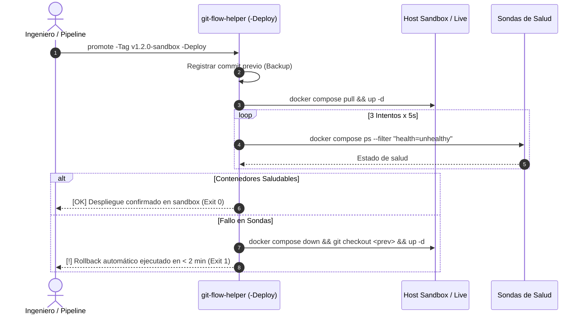

# Manual de Operación: Despliegue Automatizado por Etiquetas (`git-flow-helper.ps1`)

> **Ecosistema**: AAGY (cualquier repo consumidor)  
> **Ubicación Canónica**: `scripts/ps1/git-flow-helper.ps1` y `git-flow-helper.sh`  
> **Gobernanza**: ADR-0006 (Trunk-Based Development & Multi-Tier Promotion)  

---

## 1. Filosofía de Promoción Multi-Tier

El repo consumidor implementa un modelo de desarrollo basado en tronco canónico (*Trunk-Based Development*):

- Todo cambio se integra exclusivamente en `main` mediante PRs aisladas con squash, que fusiona una persona (`LOCAL`).
- La promoción hacia entornos físicos de prueba (`SANDBOX`) y producción (`LIVE`) se orquesta a través de **etiquetas Git semánticas inmutables**:
  - `SANDBOX`: etiqueta `vX.Y.Z-sandbox` desplegada en el host `hosts.sandbox`.
  - `LIVE`: etiqueta `vX.Y.Z` desplegada en el host `hosts.live`.

Los hosts no viven en el plugin: se leen de la capa de entorno de `aagy_config`
(`<AAGY_ENV_DIR>/aagy/env.json`) o de `AAGY_HOSTS_SANDBOX` / `AAGY_HOSTS_LIVE`.
Si falta el del entorno pedido, `-Deploy` para y dice qué clave declarar.

La acción `promote` de `git-flow-helper.ps1` automatiza el etiquetado, la publicación en GitHub y el despliegue físico desatendido con sondas de salud y rollback instantáneo.

---

## 2. Diagrama de Secuencia del Despliegue y Rollback



---

## 3. Comandos y Sintaxis CLI

### PowerShell (Windows 11)

```powershell
# 1. Simulación segura previa (-DryRun)
pwsh -File scripts/ps1/git-flow-helper.ps1 -Action promote -Tag v1.2.0-sandbox -Deploy -DryRun

# 2. Despliegue en SANDBOX (hosts.sandbox)
pwsh -File scripts/ps1/git-flow-helper.ps1 -Action promote -Tag v1.2.0-sandbox -Deploy

# 3. Despliegue en LIVE (hosts.live)
pwsh -File scripts/ps1/git-flow-helper.ps1 -Action promote -Tag v1.2.0 -Deploy -Environment live

# 4. Promoción clásica sin despliegue (solo etiquetado Git)
pwsh -File scripts/ps1/git-flow-helper.ps1 -Action promote -Tag v1.2.0-sandbox
```

### Bash / Linux (WSL / Debian 12)

```bash
# Simulación en Bash
scripts/sh/git-flow-helper.sh --action promote --tag v1.2.0-sandbox --deploy --dry-run

# Despliegue real
scripts/sh/git-flow-helper.sh --action promote --tag v1.2.0-sandbox --deploy
```

---

## 4. Garantía de Rollback Desatendido (< 2 minutos)

Si cualquier contenedor falla su liveness probe tras 3 intentos sucesivos (15 segundos):

1. Se interrumpe la secuencia de promoción.
2. Se ejecuta `docker compose down`.
3. Se restaura el commit previo con `git checkout <prevCommit>`.
4. Se levanta la versión estable previa con `docker compose up -d`.
5. Se finaliza con código de salida `1` para alertar al operador sin dejar servicios degradados.
