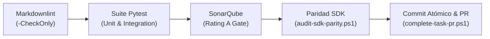

# Manual de Operación: Linter de Paridad Estática de Contratos SDK (`audit_sdk_parity.py`)

> **Ecosistema**: AAGY Ecosystem & Home-Lab  
> **Ubicación Canónica**: `scripts/py/audit_sdk_parity.py`  
> **Wrappers CLI**: `scripts/ps1/audit-sdk-parity.ps1` y `audit-sdk-parity.sh`  
> **Compuerta CI/CD**: Fase 4 del Engineering Lifecycle (`complete-task-pr.ps1`)  

---

## 1. Propósito y Filosofía Arquitectónica

En una arquitectura de microservicios distribuida con monorepo (como `home-lab`), los servicios en `services/` y `cluster/` exponen contratos REST y modelos consumidos a través de la biblioteca cliente unificada `home-lab-sdk/`.

El **Linter de Paridad Estática de Contratos** previene el *contract drift* mediante análisis estático rápido ($< 150\text{ ms}$) y determinista (Python stdlib pura), extrayendo los endpoints públicos declarados en controladores backend y verificando que el SDK cliente polyglot (TypeScript/Angular, Go, Python, Java) contenga las rutas o llamadas correspondientes.

### Principios Fundamentales

1. **Zero Runtime Overhead**: Análisis puramente léxico y sintáctico sin levantar contenedores ni servidores.
2. **Exclusión Inteligente de Rutas Internas**: Ignora automáticamente `/metrics`, `/health`, `/livez`, `/readyz`, `/debug/*`, `/ping` y endpoints de documentación OpenAPI/Swagger.
3. **Omisión Elegante (Safe Skip)**: Si se ejecuta en un repositorio de tooling como `aagy` (sin `services/` ni `home-lab-sdk/`), retorna código `0` y estado `SKIPPED`, evitando falsos positivos.
4. **Normalización de Parámetros**: Homologa parámetros en formato Go (`:id`), FastAPI (`{id}`) y Spring Boot (`{id}`) para coincidencia exacta con clientes.

---

## 2. Sintaxis y Opciones CLI

### PowerShell (Windows 11)

```powershell
# Ejecución estándar sobre la raíz del repositorio
pwsh -File scripts/ps1/audit-sdk-parity.ps1

# Especificando directorios personalizados
pwsh -File scripts/ps1/audit-sdk-parity.ps1 -ServicesDir "services" -SdkDir "home-lab-sdk"

# Salida estructurada en JSON para pipelines CI/CD
pwsh -File scripts/ps1/audit-sdk-parity.ps1 -Json

# Modo no estricto (advertencia sin código de salida 1)
pwsh -File scripts/ps1/audit-sdk-parity.ps1 -NoStrict
```

### Bash / Linux (WSL / Debian 12)

```bash
# Ejecución estándar
scripts/sh/audit-sdk-parity.sh

# Con salida JSON
scripts/sh/audit-sdk-parity.sh --json
```

---

## 3. Formato de Salida

### Salida Tabular en Consola

```text
Estado de Paridad SDK: [PASS]
Total de Endpoints Publicos: 14
Endpoints Cubiertos en SDK:  14

Detalles: 14/14 endpoints cubiertos en SDK.
```

### Salida ante Divergencia (`FAIL` - Código 1)

```text
Estado de Paridad SDK: [FAIL]
Total de Endpoints Publicos: 15
Endpoints Cubiertos en SDK:  14

Endpoints Huerfanos (sin cliente en SDK):
  - [POST] /api/v1/transactions/export (fuente: services/kakebo/router.go)

Detalles: 1 endpoints carecen de cliente en SDK.
```

### Salida JSON (`--json`)

```json
{
  "parity_status": "PASS",
  "total_endpoints": 14,
  "covered_endpoints": 14,
  "missing_endpoints": [],
  "details": "14/14 endpoints cubiertos en SDK."
}
```

---

## 4. Integración en el Flujo de Integración (`complete-task-pr.ps1`)

`complete-task-pr.ps1` ejecuta automáticamente la auditoría de paridad en el paso 7.3 previo al commit atómico y la apertura de PR:



Si se detectan endpoints en microservicios sin cliente en `home-lab-sdk/`, la integración se detiene de inmediato requiriendo sincronizar el SDK con `sdk-synchronizer` antes de volver a ejecutar.
