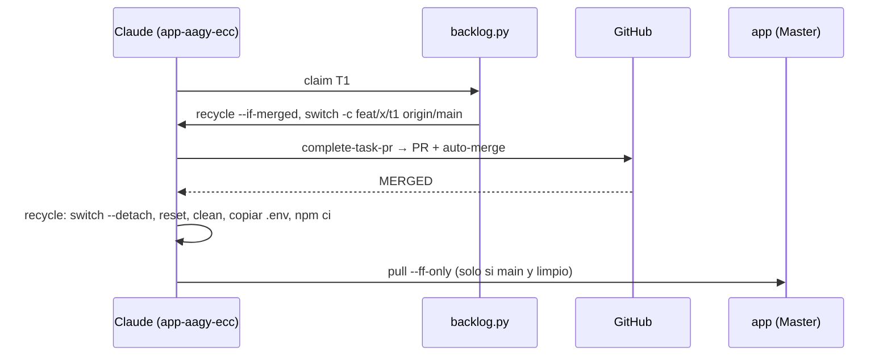

# Fase 2: Plan de Acción, Diseño Arquitectónico y Estrategia TDD — Un worktree por agente

> **Referencia de Gobernanza**: Fase 2 del Workflow de Ingeniería AAGY / proyecto consumidor
> **ID de Tarea**: `feat/aagy/agent-worktrees`
> **Requisitos**: [`REQ_aagy_agent_worktrees.md`](REQ_aagy_agent_worktrees.md) (APROBADO 2026-11-22)
> **Fecha**: `2026-11-22` | **Autor/Rol**: `Claude (plan) / Master (aprobación)`
> **Estado**: `APROBADO` (Master, 2026-11-22, decisiones de la §10)
> **Ubicación en el repo**: `doc/06-backlog/plans/PLAN_aagy_agent_worktrees.md`

---

## 1. Prerrequisitos

1. PR #56 (backlog compartido, `backlog.py`) y PR #55 (hooks de nombres de rama) en `main`. Ya lo están (`main` @ `b74fc3a`).
2. `git` ≥ 2.38 (`git worktree add --detach`, `git switch --detach`) y `gh` autenticado en equipo local.
3. Tests con `pytest` y repos git temporales; los que necesitan `pwsh` o `gh` real se saltan si no están.

---

## 2. Inventario de Reutilización (DRY First)

| Pieza existente | Uso en este plan |
| :--- | :--- |
| `scripts/py/backlog.py`: `Repo`, `run_git`, `state_lock`, `slugify` | Detección del clon principal (`git-common-dir`), ejecución de git y bloqueo de fichero. Se importan, no se copian. |
| `$(git common dir)/aagy-backlog/state.json` | Sigue siendo el estado compartido. Se añade el campo `agent_worktree` por entrada. |
| `scripts/py/validate_branch.py` | Validar la rama que se crea en el worktree. |
| `aagy-ecc/scripts/hooks/safety_check.py` y `scripts/ps1/aagy.ps1 hook-safety` | Ya leen el payload PreToolUse de cada harness. La guarda de worktree se añade como una función más, no como un hook nuevo de Bash. |
| `scripts/py/doctor_core.py` | Nuevo check `DOC-15`. |
| `scripts/py/sync_aagy_ecc.py` | Espejar el script nuevo a `aagy-ecc/scripts/py/`. |

Sin dependencias nuevas: Python stdlib + `git` + `gh`.

---

## 3. Arquitectura

```text
<padre>\
├── app\               ← Master (main). Clon principal: tiene el .git real.
├── app-aagy\          ← Antigravity. Worktree, HEAD desacoplado o rama de tarea.
├── app-aagy-ecc\      ← Claude Code. Worktree, HEAD desacoplado o rama de tarea.
├── aagy\  aagy-aagy\  aagy-aagy-ecc\   ← mismo patrón para el repo aagy
```

```text
scripts/py/agent_worktree.py      ← núcleo: init | status | where | recycle | guard
scripts/ps1/aagy.ps1 agent-worktree, scripts/sh/aagy.sh agent-worktree   ← wrappers
aagy-ecc/scripts/py/agent_worktree.py   ← espejo (sync_aagy_ecc)
aagy-ecc/commands/aagy-worktree.md      ← /aagy-worktree init|status|recycle
skills/agent-worktrees/SKILL.md         ← punto de entrada en Antigravity (y espejo)
.governance/agent-worktrees.json        ← opcional, por repo consumidor (copia y regeneración)
```

### 3.1 Identidad del agente y rutas

- `AGENTS = {"agy": "-aagy", "claude": "-aagy-ecc"}`.
- Clon principal = padre de `git rev-parse --git-common-dir`. Ruta del agente = `<padre del principal>/<nombre del principal><sufijo>`.
- `where --json` devuelve `{role: "main"|"agy"|"claude"|"other", main, agy, claude}` según la carpeta actual. Lo usan los hooks, `complete-task-pr` y `backlog.py`.
- Marcador de activación: `$(git common dir)/aagy-worktrees.json` (lo escribe `init`). Sin marcador, la guarda no actúa: los repos que no usan el modelo siguen igual.

### 3.2 `init`

1. `git fetch origin main`.
2. Por cada agente sin worktree: `git worktree add --detach <ruta> origin/main`.
3. Copiar configuración y regenerar dependencias (§3.4).
4. Escribir el marcador. Idempotente: si la ruta ya es un worktree del mismo clon, solo lo informa.

### 3.3 `recycle [--if-merged] [--hard-recreate] [--no-install]`

Todo bajo `state_lock`. Pasos:

| # | Paso | Si falla |
| :--- | :--- | :--- |
| 1 | Rama actual. Si ya está desacoplada en `origin/main` y limpia, ir al paso 9. | — |
| 2 | Trabajo sin guardar: `git status --porcelain`, commits sin push (`@{u}..HEAD`, o `origin/main..HEAD` si no hay upstream y la PR no está fusionada), `git stash list`. | **Bloquea** (código 3) y lista qué hay. No toca nada (RF-05). |
| 3 | PR fusionada: `gh pr view <rama> --json state,mergedAt`. El merge es squash, así que no vale comprobar ancestros. | No fusionada: con `--if-merged` sale 0 en silencio; sin él, código 4. Sin `gh`: código 5 con aviso. |
| 4 | `git fetch --prune origin`. | Aborta. |
| 5 | Limpieza en sitio: `git switch --detach origin/main` → `git reset --hard` → `git clean -ffdx`. | Si `clean` no puede borrar (fichero bloqueado en Windows) o con `--hard-recreate`: paso 6. |
| 6 | Respaldo: `git worktree remove --force` + `git worktree add --detach <ruta> origin/main`. | Si la carpeta sigue bloqueada, informa de la ruta y del proceso probable (IDE abierto). |
| 7 | `git branch -D <rama>` y `git worktree prune`. | Aviso. |
| 8 | Liberar la entrada del backlog (`state.json`) que apuntaba a este worktree. | Aviso. |
| 9 | Copiar configuración y regenerar dependencias (§3.4). | Aviso: el worktree queda limpio aunque falle un instalador. |
| 10 | Actualizar el principal (RF-08): si está en `main` y `status --porcelain` vacío → `git -C <principal> pull --ff-only`. | Si no: no lo toca y avisa ("tienes cambios / estás en otra rama"). |

Códigos de salida: `0` hecho o nada que hacer, `3` bloqueado por trabajo sin guardar, `4` PR no fusionada, `5` sin `gh`, `1` error.

### 3.4 Configuración y generados (P-08)

`.governance/agent-worktrees.json` (opcional; estos son los valores por defecto):

```json
{
  "copy": [".env", ".env.*", "**/.env", "**/.env.*"],
  "copy_exclude": ["**/node_modules/**", "**/.venv/**"],
  "install": "auto",
  "install_timeout_s": 900
}
```

- **copy**: ficheros no versionados que se copian del principal al worktree, solo si existen en el principal y git los ignora.
- **install "auto"**: regenera solo lo que el principal tiene generado: `node_modules` (`npm ci`, `pnpm install --frozen-lockfile`, `yarn install --frozen-lockfile` o `bun install`, según el lockfile) y `.venv` (`uv sync`, `poetry install` o `venv` + `pip install -r requirements.txt`). Maven, Gradle y Go usan cachés globales del usuario, así que no hay nada que regenerar por worktree. `install` también acepta `"none"` o una lista `{cwd, argv}`, y `extra_install` añade comandos.
- Los generados nunca se copian: `git clean -ffdx` los borra y el paso 9 los regenera.

### 3.5 Guarda de escritura (RF-03, P-09, P-10)

`agent_worktree.guard(agent, tool, payload) -> Optional[str]` (motivo del bloqueo). Solo con marcador activo.

- **Ficheros** (Claude `Write|Edit|MultiEdit|NotebookEdit`; agy `write_file|edit_file`): se resuelve la ruta absoluta (también rutas relativas y `..`). Se bloquea si cae en el principal o en el worktree del otro agente. Las lecturas no se bloquean.
- **Comandos** (Claude `Bash|PowerShell`; agy `run_command`): se bloquea si el `cwd`, un `cd <ruta>`, un `git -C <ruta>` o un `Set-Location` apuntan al principal o al otro worktree y el comando escribe (`git` que no sea `status|log|diff|show|fetch|branch --list`, redirecciones `>`, `rm`, `mv`, `cp` con destino allí, `Remove-Item`, `Set-Content`…). También se bloquea `git worktree add|remove|move` a mano, salvo desde `agent_worktree.py`.
- **Worktree nativo de Claude Code** (P-10): se deniega la herramienta `EnterWorktree` y `claude --worktree` / `-w`.
- Mensaje: `[WORKTREE-GUARD] Claude trabaja en C:\...\app-aagy-ecc. No puede escribir en C:\...\app.`
- Si la sesión arrancó fuera de su worktree, el SessionStart de Claude lo avisa con la ruta correcta.

### 3.6 Cambios en piezas existentes

| Pieza | Cambio |
| :--- | :--- |
| `aagy complete-task-pr` §12 | Si `where` da `agy`/`claude`: tras `gh pr merge`, esperar hasta 120 s a `state=MERGED` (el auto-merge es asíncrono) y llamar a `recycle`. Si no se fusiona a tiempo, salir avisando de que el reciclado se hará en el siguiente `claim` o SessionStart. En el principal: sustituir `git checkout -f` por `git checkout` (sin `-f`) y abortar si hay cambios. |
| `backlog.py claim` | En un worktree de agente: primero `recycle --if-merged`; si el worktree ya está en otra rama de tarea sin fusionar, falla (una tarea a la vez por agente). Si no, `git switch -c <rama> origin/main` (o `git switch <rama>` si existe en remoto, para relevos) y registra `agent_worktree`. `--worktree` (`<repo>.wt/<id>`) sigue disponible como excepción (P-07). |
| `backlog.py handoff` | Antes de entregar: `git push` de la rama y `git switch --detach`, para que el otro agente pueda abrirla en su worktree. Falla si hay cambios sin commit. |
| `backlog.py done` | Llama a `recycle --if-merged`. |
| `aagy-ecc` SessionStart | Nueva entrada (timeout 300 s): `agent_worktree.py --quiet recycle --if-merged`, más el aviso de carpeta equivocada. |
| Antigravity | No tiene SessionStart: el reciclado tras merge asíncrono ocurre en `complete-task-pr`, en el siguiente `claim` o con el workflow `agent-worktrees`. |
| `doctor_core.py` | `DOC-15 Worktrees de agente` (ámbito repo): existen los dos, pertenecen al mismo clon, ninguno tiene `main`, el principal no está desacoplado. `--fix` → `init`. |
| `rules/AGENTS.md` | Regla Tier 1: "cada agente trabaja solo en su worktree; el checkout principal es de Master". |
| Docs | `MANUAL_agent_worktrees.md` (runbook), ADR-0006, entrada en `LOG.md`, actualizar `MANUAL_shared_backlog.md`. |

---

## 4. Flujo de una tarea



---

## 5. Estrategia TDD

`scripts/py/tests/test_agent_worktree.py`, con un remoto *bare* y un clon temporales; `gh` se simula con un ejecutable falso en `PATH`.

| Test | Cubre |
| :--- | :--- |
| `test_init_creates_two_detached_worktrees` | CA-01, idempotencia |
| `test_where_roles` | `main` / `agy` / `claude` / `other` |
| `test_recycle_merged_clean` | CA-03: queda en `origin/main`, rama local borrada |
| `test_recycle_blocks_on_dirty` / `_on_unpushed` / `_on_stash` | CA-04 |
| `test_recycle_not_merged_if_merged_flag` | Salida 0 sin cambios |
| `test_recycle_fallback_recreate` | Paso 6 forzado con `--hard-recreate` |
| `test_recycle_copies_env_and_runs_install` | P-08 con un instalador falso |
| `test_recycle_updates_main_only_when_clean` | CA-05 en sus dos ramas |
| `test_guard_file_paths` / `test_guard_commands` | CA-02: rutas absolutas, relativas, `..`, `git -C`, `cd`, lecturas permitidas |
| `test_guard_inactive_without_marker` | Repos que no usan el modelo |
| `test_backlog_claim_in_agent_worktree` / `test_handoff_between_worktrees` | RF-09, RF-10, CA-06 |
| `test_complete_task_pr_in_worktree` (pwsh, se salta si no hay) | CA-07 |

---

## 6. Pasos de implementación (una sola PR: `feat/aagy/agent-worktrees`, D-01)

1. [x] Tests rojos de `agent_worktree.py` (`init`, `where`, `recycle`).
2. [x] `agent_worktree.py` + wrappers ps1/sh.
3. [x] Copia de configuración e instaladores (§3.4).
4. [x] `guard()` + integración en `safety_check.py` (Claude) y `aagy hook-safety` (agy); matchers de ficheros y `EnterWorktree` en `aagy-ecc/hooks/hooks.json` y `hooks.json`.
5. [x] `backlog.py`: `claim`, `handoff`, `done`.
6. [x] `aagy complete-task-pr` §12.
7. [x] SessionStart de `aagy-ecc`; `/aagy-worktree`; skill `agent-worktrees`.
8. [x] `DOC-15` en ambos doctors.
9. [x] Regla Tier 1, runbook, ADR-0006, `LOG.md`; `sync_aagy_ecc.py` y `audit_plugin_parity.py` en verde; subir versión (4.4.0).

---

## 7. Verificación en equipo local

1. `aagy agent-worktree init` en `app` y en `aagy`.
2. Abrir `app-aagy` en Antigravity y `app-aagy-ecc` en Claude Code.
3. Tarea de prueba en cada uno → PR → merge → comprobar reciclado y que `app` avanza solo.
4. Con un fichero sin commit en `app`, comprobar que no se toca y que sale el aviso.
5. Intentar que Claude edite `app` → bloqueado.
6. `aagy-ecc-doctor` y `aagy-doctor` → `DOC-15 PASS`.

---

## 8. Migración

- Hoy los dos agentes trabajan en `app` y `aagy`. Antes de `init`, cada sesión abierta tiene que terminar o hacer `handoff`: su rama se empuja y luego se abre en el worktree del agente.
- Los worktrees `<repo>.wt/<id>` ya creados siguen funcionando; `DOC-15` los lista como aviso.

---

## 9. Riesgos

| Riesgo | Mitigación |
| :--- | :--- |
| `npm ci` o similares tardan varios minutos | Timeout configurable; `--no-install` para reciclar rápido; el SessionStart tiene 300 s. |
| El hook de 5 s actual no basta para resolver rutas | La guarda solo lee el marcador y compara rutas, sin llamar a git en el caso normal. |
| La guarda de comandos no es perfecta (un script puede escribir donde quiera) | Es una red de seguridad; la regla Tier 1 y el cwd fijo hacen el resto. Lo dejo dicho en el runbook. |
| Squash merge: no se puede saber si está fusionada solo con git | Siempre por `gh`; sin `gh`, no se recicla. |

---

## 10. Decisiones de Master (2026-11-22)

| ID | Decisión |
| :--- | :--- |
| D-01 | Una sola PR. |
| D-02 | `app` no tiene generados fuera de los lockfiles: basta con `install: "auto"`. |
