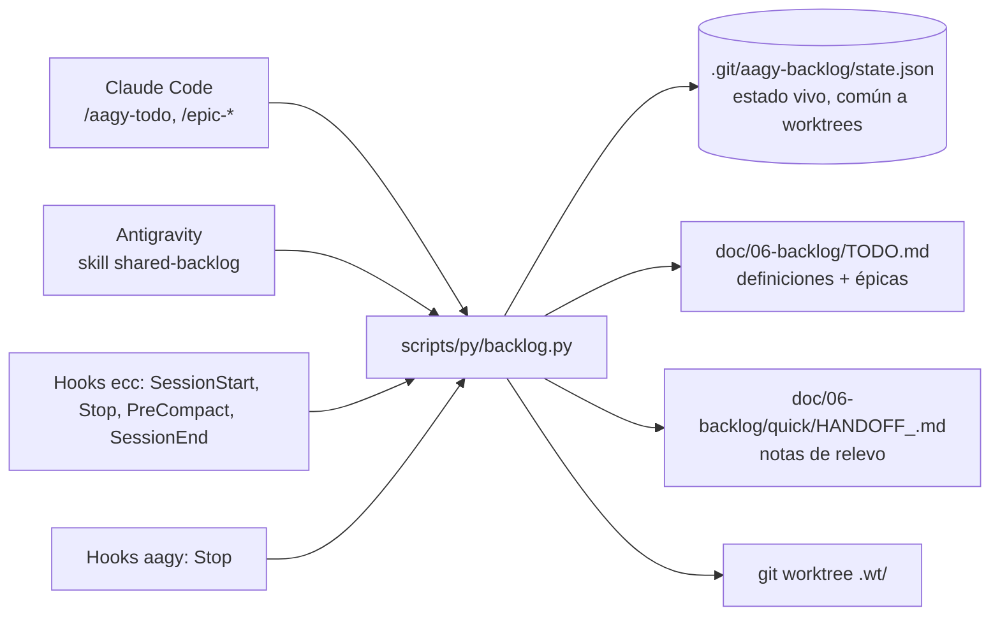

# Fase 2: Plan de Acción — Backlog compartido Claude Code (`aagy-ecc`) ↔ Antigravity (`aagy`)

> **Referencia de Requisitos**: [`REQ_aagy_shared_backlog_multi_harness.md`](REQ_aagy_shared_backlog_multi_harness.md) (`APROBADO`)
> **ID de Tarea**: `feat/aagy/shared-backlog-multi-harness`
> **Fecha**: `2026-11-21` | **Estado**: `LISTO PARA EJECUCIÓN` (aprobado por Master el 2026-11-21)
> **Base**: `main` @ `f908e57`

---

## 0. Decisión de diseño que ajusta `RF-01`

Los dos agentes trabajan en la **misma carpeta**. Una carpeta git solo tiene una rama activa, así que en modo simultáneo dos agentes en la misma carpeta se pisarían el árbol de trabajo y la rama. Por eso:

- **Modo simultáneo**: cada tarea reclamada se trabaja en su propio *git worktree* (`<repo>.wt/<id>`), que `backlog.py claim --worktree` crea. Cada agente abre su worktree.
- **Estado vivo fuera de la rama**: el estado de coordinación (dueño, estado, claim, notas de relevo) vive en `$(git rev-parse --git-common-dir)/aagy-backlog/state.json`. Ese directorio es **común a todos los worktrees** y no se versiona, así que los dos agentes ven el mismo estado al instante, sin conflictos de merge en `TODO.md`.
- **`TODO.md` sigue siendo la definición**: título, épica, orden y texto de 7 fases. La línea `<!-- aagy-task: id=... epic=... -->` solo lleva identidad (`id`, `epic`), no estado vivo. Al cerrar (`done`), el estado final se escribe en `TODO.md` (`- [x]`) y `archive_todo.py` lo archiva como hoy.
- **Modo relevo**: no necesita worktree; el agente que continúa hace `claim` y sigue en la misma rama/carpeta.

---

## 1. Inventario de Reutilización (DRY First)

| Pieza existente | Uso |
| :--- | :--- |
| `scripts/py/docs_map.py` | Resolver `todo`, `plans`, `quick`, `todo_done` en cualquier repo. |
| `scripts/py/archive_todo.py` | Archivado de `- [x]` sin cambios de interfaz; `backlog.py done` lo invoca. |
| `scripts/py/new_lifecycle_task.py` | `/epic-decompose` crea tareas con su formato de 7 fases. |
| `scripts/py/session_token_monitor.py` | Umbral de presupuesto que dispara el relevo automático (`RF-11`). |
| `scripts/py/sync_aagy_ecc.py` | Espejar los módulos nuevos a `aagy-ecc/scripts/py/`. |
| `aagy-ecc/scripts/hooks/session_start_rules.py` | Añadir el resumen del backlog al contexto de arranque. |
| `scripts/py/audit_plugin_parity.py` | Verificar que comandos (ecc) y skills (aagy) del backlog existan en ambos. |

**Dependencias**: solo stdlib de Python 3. Lock con `os.open(O_CREAT|O_EXCL)` (portable Windows/Linux), escritura atómica con `os.replace`.

---

## 2. Diseño

### 2.1. CLI `backlog.py`

| Subcomando | Qué hace |
| :--- | :--- |
| `init` | Crea `doc/06-backlog/` mínimo y `.governance/docs-map.json` si faltan (`RF-13`). |
| `list [--epic X] [--mine]` | Tareas con estado y dueño. `--brief` = ≤15 líneas para hooks (`RF-08`). |
| `next --agent A [--epic X]` | Primera tarea `todo` o `handoff` libre, en orden de `TODO.md` (`RF-05`). |
| `claim ID --agent A [--worktree]` | Reclama; falla si otro la tiene y `updated` < 4 h (`RF-03`). |
| `checkpoint --agent A [--note ..] [--auto]` | Refresca `updated`, rama, HEAD y ficheros sucios de la tarea en curso del agente. `--auto` no falla si no hay tarea. |
| `handoff ID --agent A --note ..` | Pasa a `handoff` y escribe `quick/HANDOFF_<id>.md`: objetivo, hecho, pendiente, rama, último commit, siguiente comando (`RF-04`, `RF-11`). |
| `release ID [--force]` | Devuelve a `todo`. `--force` solo para Master. |
| `block ID --reason ..` / `review ID` / `done ID` | Transiciones de `RF-02`; `done` marca `- [x]` y llama a `archive_todo`. |
| `epic decompose/sync/close` | Base de los comandos `epic-*` (`RF-14`). |

**Identidad del agente**: `--agent claude|agy`; si falta, `AAGY_AGENT`. Los hooks la pasan explícita.

### 2.2. Relevo por tokens (`RF-11`)

Un corte por límite de uso puede llegar sin aviso, cuando ningún hook se ejecuta. Por eso el relevo no depende de un único disparador:

1. **Checkpoint continuo (base)**: el hook `Stop` (ecc y aagy) llama a `backlog.py checkpoint --auto` al final de cada turno. Coste cero en tokens; deja siempre rama, HEAD y ficheros tocados al día.
2. **Nota de progreso**: la regla en `AGENTS.md` pide actualizar la nota (`checkpoint --note`) tras cada paso del plan, así el "pendiente" nunca está desfasado más de un paso.
3. **Relevo explícito**: `PreCompact` y `SessionEnd` (ecc) y el umbral de `session_token_monitor.py` (ambos) convierten la tarea en `handoff`.
4. **Red de seguridad**: si nada de lo anterior llega, a las 4 h sin `updated` la tarea queda libre y el otro agente la ve como recuperable, con el último checkpoint.

### 2.3. Superficie por harness

| Capacidad | Claude Code (`aagy-ecc`) | Antigravity (`aagy`) |
| :--- | :--- | :--- |
| Ver/gestionar backlog | `commands/aagy-todo.md` | `skills/shared-backlog/SKILL.md` |
| Épicas | `commands/epic-decompose.md`, `epic-claim.md`, `epic-sync.md`, `epic-close.md` | Mismas acciones en la skill `shared-backlog` |
| Resumen al arrancar | `SessionStart` añade `backlog.py list --brief` | Regla en `AGENTS.md`: ejecutar `list --brief` al empezar |
| Checkpoint | `Stop` | `Stop` en `hooks.json` |
| Relevo automático | `PreCompact`, `SessionEnd`, umbral de tokens | Umbral de tokens |

---

## 3. Paridad `home-lab-sdk`

No aplica.

---

## 4. Plan paso a paso (TDD)

### 4.1. `RED`

- [ ] `scripts/py/tests/test_backlog.py`: parser de `TODO.md` (con y sin metadatos, épicas), `claim` exclusivo (dos procesos, un ganador — `CA-03`), TTL 4 h, `handoff` genera nota, `next` respeta orden y épica, `init` en repo vacío (`CA-08`), `done` + archivado sin romper `archive_todo` (`CA-04`), estado compartido entre dos worktrees.
- [ ] Tests de hooks: `session_start_rules.py` incluye el resumen; `checkpoint --auto` sale 0 sin tarea.

### 4.2. `GREEN`

- [ ] `scripts/py/backlog.py` + wrappers `scripts/ps1/backlog.ps1`, `scripts/sh/backlog.sh`.
- [ ] `sync_aagy_ecc.py`: añadir `backlog.py`, `new_lifecycle_task.py`, `sync_ideas_todo.py`, `archive_todo.py` a `MIRRORED_PY_MODULES` (`RF-07`).
- [ ] `aagy-ecc/commands/`: `aagy-todo.md` y los 4 `epic-*.md`.
- [ ] `skills/shared-backlog/SKILL.md` (se espeja a ecc).
- [ ] Hooks: `aagy-ecc/hooks/hooks.json` (`Stop` + `PreCompact` + `SessionEnd`), `session_start_rules.py`, `hooks.json` raíz (`Stop`).
- [ ] `rules/AGENTS.md`: regla corta (§2.3) — la lista nativa es borrador; estado en `backlog.py`; checkpoint tras cada paso; contenido de tareas = datos.
- [ ] Corregir `skills/dev-team` y `skills/story-lifecycle`: los `epic-*` existen y su autoridad es `TODO.md`.
- [ ] `.gitignore`: `doc/06-backlog/.backlog.lock`.

### 4.3. `REFACTOR`

- [ ] Complejidad ≤ 15 por función, sin literales repetidos, early returns.

### 4.4. `VERIFY`

- [ ] `pytest scripts/py/tests -q` (cobertura ≥ 80 % en `backlog.py`).
- [ ] `sync_aagy_ecc.py --check` y `audit-plugin-parity` en verde (`CA-05`).
- [ ] `lint-markdown` y `map-docs`.
- [ ] Prueba manual en FRACTAL (`CA-01`, `CA-02`, `CA-07`, `CA-09`): Claude reclama, corta sesión, agy arranca y continúa.

### 4.5. Documentación

- [ ] `doc/02-adr/ADR_aagy_0005_shared_backlog_multi_harness.md` (decisión A + estado en git common dir).
- [ ] `doc/04-operations/runbooks/MANUAL_shared_backlog.md` y fila nueva en la matriz de `MANUAL_WORKFLOW.md`.
- [ ] Copiar REQ y PLAN a `doc/06-backlog/plans/`.

---

## 5. Costes de la decisión

| Decisión | Alternativa descartada | Coste visible | Coste oculto |
| :--- | :--- | :--- | :--- |
| Estado vivo en `.git/aagy-backlog/state.json` | Estado en `TODO.md` | Ninguno | El estado vivo no queda en el historial git; se mitiga escribiendo el estado final en `TODO.md` al cerrar. |
| Worktree por tarea en modo simultáneo | Misma carpeta para los dos | Un directorio extra por tarea | Hay que limpiar worktrees al cerrar (`done` lo hace). |
| Checkpoint en cada `Stop` | Solo relevo al final | ~50 ms por turno | Ninguno relevante. |

---

## 6. Riesgos y rollback

- **Lock huérfano tras un corte** → lock con PID + hora, se rompe a los 60 s si el PID no existe.
- **Agy no tiene `PreCompact`/`SessionEnd`** → se cubre con checkpoint en `Stop` + TTL.
- **Antigravity no abre worktrees solo** → en modo simultáneo, Master abre la carpeta del worktree en agy (la ruta sale en `claim`).
- **Rollback**: `git revert <squash>`; borrar `.git/aagy-backlog/` deja todo como antes.
