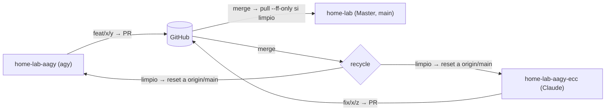

# Fase 1: Toma de Requisitos — Un worktree por agente (`home-lab-aagy` / `home-lab-aagy-ecc`)

> **Referencia de Gobernanza**: Fase 1 del Workflow de Ingeniería AAGY / Home-Lab
> **ID de Tarea**: `feat/aagy/agent-worktrees`
> **Fecha**: `2026-11-21` | **Autor/Rol**: `Claude (toma de requisitos) / Master (aprobación)`
> **Estado**: `APROBADO` (Master, 2026-11-22, decisiones de la §8)
> **Ubicación en el repo**: `doc/06-backlog/plans/REQ_aagy_agent_worktrees.md`

---

## 0. Estado actual (hallazgos en `main` @ `b74fc3a`)

| Pieza | Dónde | Qué hace hoy | Problema para este requisito |
| :--- | :--- | :--- | :--- |
| Checkout principal | `C:\Workspace\projects\home-lab` (y `...\aagy`) | Master y los dos agentes trabajan en la misma carpeta, en `main` | Un agente puede pisar cambios sin commit de Master o del otro agente. |
| Worktree por tarea | `backlog.py claim --worktree` → `<repo>.wt/<id>` | Crea un worktree por tarea en modo simultáneo; `done` lo borra si está limpio | La ruta cambia en cada tarea: Antigravity tiene que abrir una carpeta nueva cada vez. No hay carpeta fija por agente. |
| Estado vivo del backlog | `$(git common dir)/aagy-backlog/state.json` | Común a todos los worktrees de un clon | Ya sirve tal cual: los worktrees por agente lo comparten sin cambios. |
| Cierre de tarea | `scripts/ps1/complete-task-pr.ps1` §12 | Tras el merge hace `git checkout -f main` + `git pull` + `git branch -D` **en la carpeta actual** | Dentro de un worktree de agente **falla**: git no permite tener `main` en dos worktrees a la vez (ya está en `home-lab`). Y `-f` descarta cambios sin aviso. |
| Merge en GitHub | Repo con auto-merge y *delete branch on merge* | El merge puede ocurrir minutos después de abrir la PR | El reciclado local no puede depender solo de que el script vea el merge en el momento. |
| Nombres de rama | `validate_branch.py` + hooks PreToolUse (PR #55) | Solo `<type>/<project>/<name>` | Claude Code nativo (`claude --worktree`, `EnterWorktree`) crea `.claude/worktrees/<n>` con ramas `worktree-*`, que los hooks ya rechazan. |

**Conclusión**: el estado compartido ya existe. Falta (1) una carpeta fija y aislada por agente, (2) un reciclado seguro tras el merge, (3) proteger el checkout de Master y (4) que `complete-task-pr` sepa que está en un worktree.

---

## 1. Contexto, Necesidad y Objetivos

- **Problema**: Claude Code y Antigravity comparten carpeta con Master. Cualquier cambio sin commit, `checkout` o `reset` de uno afecta a los otros dos.
- **Objetivo principal**: cada agente trabaja siempre en **su** worktree fijo del mismo clon; Master se queda con el checkout principal, que se mantiene al día solo. Al fusionarse la PR de un agente, su worktree vuelve a un estado limpio sobre `origin/main`, listo para la siguiente tarea, en la misma ruta.
- **Alcance (`In-Scope`)**:
  - Dos worktrees persistentes por repositorio: `home-lab-aagy` (Antigravity) y `home-lab-aagy-ecc` (Claude Code).
  - Script determinista único `scripts/py/agent_worktree.py` (+ wrappers ps1/sh), espejado a `aagy-ecc`.
  - Reciclado tras merge (borrar y regenerar limpio) con protección de trabajo no guardado.
  - Autoactualización del checkout principal de Master tras cada merge.
  - Guardas en los hooks de ambos plugins: cada agente solo escribe en su worktree.
  - Adaptar `complete-task-pr` y `backlog.py` (claim, handoff, done) al modelo por agente.
  - Comprobación en `aagy-doctor` / `aagy-ecc-doctor`.
- **Fuera de Alcance (`Out-of-Scope`)**:
  - Contenedores o VMs por agente.
  - Más de un worktree por agente a la vez (ver P-07).
  - Cambiar el flujo de PR o la política de ramas.

---

## 2. Opciones evaluadas para "borrar y generar uno limpio"

| Opción | Cómo | A favor | En contra |
| :--- | :--- | :--- | :--- |
| **A. Borrar y recrear** | `git worktree remove` + `git worktree add --detach <ruta> origin/main` | Literal: carpeta nueva, cero restos | En Windows falla si Antigravity, VS Code o un terminal tienen la carpeta abierta (ficheros bloqueados). Pierde `node_modules`, `.venv`, `.env`. |
| **B. Reset en sitio** | `git switch --detach origin/main` + `git reset --hard` + `git clean -fdx` (con lista de exclusiones) | Misma ruta sin bloqueo de carpeta; el IDE abierto sigue funcionando; puede conservar cachés | No es un borrado físico; un fichero bloqueado puede quedar. |
| **C. Mixta (recomendada)** | B por defecto; A si B falla, si el worktree está corrupto o con `--hard-recreate` | Resultado limpio igual que A, sin romper la sesión abierta del IDE | Dos caminos que probar. |

Las tres dejan el worktree en **HEAD desacoplado sobre `origin/main`** (no en `main`, que pertenece a Master). La rama de la siguiente tarea se crea desde ahí.

---

## 3. Requisitos Funcionales (RF)

| ID | Requisito | Prioridad |
| :--- | :--- | :--- |
| RF-01 | `agent_worktree.py init` crea, si faltan, `<padre>/<repo>-aagy` y `<padre>/<repo>-aagy-ecc` como worktrees del clon principal, desacoplados en `origin/main`. Idempotente. Para `home-lab` → `home-lab-aagy` y `home-lab-aagy-ecc`. | Must |
| RF-02 | Cada harness conoce su worktree: `aagy` → `*-aagy`, `aagy-ecc` → `*-aagy-ecc`. Al arrancar sesión fuera de él, el SessionStart avisa e indica la ruta correcta. | Must |
| RF-03 | Guarda de escritura (PreToolUse): un agente no puede escribir ficheros ni ejecutar `git commit/checkout/reset/clean/stash/push` en el checkout principal ni en el worktree del otro agente. | Must |
| RF-04 | `agent_worktree.py recycle` comprueba con `gh pr view` que la PR de la rama actual está `MERGED`, que no hay cambios sin commit y que no hay commits sin push; si todo es correcto, limpia el worktree (opción de la §2), borra la rama local y hace `git worktree prune`. | Must |
| RF-05 | Si hay trabajo no guardado (cambios sin commit, commits sin push, stash), `recycle` **no borra nada**, informa qué hay y sale con código ≠ 0 (ver P-04). | Must |
| RF-06 | Disparadores del reciclado: (a) al final de `complete-task-pr` si el merge ya ocurrió; (b) en el SessionStart del agente si su rama está fusionada (cubre el auto-merge asíncrono); (c) manual `/aagy-worktree recycle`. | Must |
| RF-07 | `complete-task-pr` detecta que corre en un worktree de agente y sustituye su §12 (`checkout -f main` + `pull`) por `recycle`. En el checkout principal mantiene el comportamiento actual. | Must |
| RF-08 | Autoactualización del checkout principal **como paso de cada `recycle`** (P-05): `git -C <principal> pull --ff-only` **solo** si está en `main` y limpio; si no, no toca nada y deja aviso en la salida del reciclado. Sin tarea programada. | Must |
| RF-09 | `backlog.py`: `claim` en un worktree de agente registra esa ruta como `worktree` y crea la rama allí, sin `<repo>.wt/<id>`; `done` llama a `recycle`. | Must |
| RF-10 | Relevo entre agentes (`handoff`): el agente que suelta empuja su rama y desacopla su worktree, para que el otro pueda hacer `git switch <rama>` en el suyo (git no deja la misma rama en dos worktrees). | Must |
| RF-11 | Tras regenerar (P-08): (a) **configuración** no versionada (`.env`, `.env.*`, y los patrones de `.governance/agent-worktrees.json`) se copia del checkout principal; (b) **generados** (`node_modules`, `.venv`, `target`, `dist`…) no se copian: se borran y se regeneran con el instalador que corresponda al lockfile (`npm ci`, `pnpm i --frozen-lockfile`, `uv sync`/`pip install -r`, `go mod download`…), declarable en el mismo JSON. | Must |
| RF-12 | `aagy-doctor` / `aagy-ecc-doctor`: nuevo check que valida que existen los dos worktrees, que apuntan al mismo clon y que ninguno tiene `main` en checkout. | Should |
| RF-13 | Mismo contrato en ambos harnesses: comando `/aagy-worktree` (Claude) y workflow/skill equivalente (Antigravity) con `init`, `status`, `recycle`. | Must |
| RF-14 | Patrón genérico `<repo>-aagy` / `<repo>-aagy-ecc` (P-02): `home-lab` y también `aagy` (`aagy-aagy`, `aagy-aagy-ecc`) y cualquier repo consumidor. | Must |

## 4. Requisitos No Funcionales (RNF)

| ID | Requisito |
| :--- | :--- |
| RNF-01 | Nunca se pierde trabajo: ninguna operación destructiva sin comprobar antes cambios sin commit, commits sin push y stash. |
| RNF-02 | Idempotente y seguro ante ejecución concurrente (mismo bloqueo de fichero que `backlog.py`). |
| RNF-03 | Windows primero (FRACTAL, PowerShell), compatible con Linux/macOS. Sin dependencias fuera de la stdlib de Python + `git` + `gh`. |
| RNF-04 | Paridad simétrica: un solo script en la raíz, espejado a `aagy-ecc` por `sync_aagy_ecc.py`; `audit_plugin_parity.py` lo comprueba. |
| RNF-05 | Tests en `scripts/py/tests/test_agent_worktree.py` con repos git temporales (init, recycle limpio, recycle bloqueado por cambios, handoff, principal sucio). |
| RNF-06 | Markdown y mensajes en español, como el resto del ciclo. |

---

## 5. Flujo propuesto

---

## 6. Criterios de Aceptación (CA)

- **CA-01**: con `home-lab` en `main`, `init` crea los dos worktrees desacoplados en `origin/main` y `git worktree list` muestra tres entradas.
- **CA-02**: Claude intenta editar un fichero en `home-lab` o en `home-lab-aagy` → el hook lo deniega con un mensaje que indica su worktree.
- **CA-03**: tras fusionarse la PR de Claude, `recycle` deja `home-lab-aagy-ecc` limpio en el commit del merge y sin la rama local.
- **CA-04**: con un fichero sin commit, `recycle` no toca nada y lo informa.
- **CA-05**: tras el merge, `home-lab` (limpio, en `main`) queda en el commit del merge; si Master tiene cambios, queda intacto y con aviso.
- **CA-06**: `handoff` de Claude a agy: agy hace `claim` y continúa la misma rama en `home-lab-aagy`.
- **CA-07**: `complete-task-pr` ejecutado dentro de un worktree de agente termina sin error y recicla.

---

## 7. Riesgos

| Riesgo | Mitigación |
| :--- | :--- |
| Carpeta abierta en el IDE impide borrarla (Windows) | Opción C: reset en sitio por defecto. |
| Auto-merge asíncrono: el script termina antes del merge | Disparador (b) en SessionStart del agente. Tu principal se actualiza en ese reciclado. |
| Un agente ignora la guarda y usa rutas absolutas | El hook resuelve rutas absolutas y relativas contra la raíz del worktree. |
| `git clean -fdx` borra `.env` o secretos locales | Lista de exclusiones + restauración RF-11. |

---

## 8. Decisiones de Master (2026-11-22)

| ID | Pregunta | Decisión |
| :--- | :--- | :--- |
| P-01 | Ubicación | Hermanos del principal: `C:\Workspace\projects\<repo>-aagy` y `<repo>-aagy-ecc`. |
| P-02 | Repos | Genérico. `home-lab` y también `aagy`. |
| P-03 | Borrar o limpiar | Opción C: limpiar en sitio, borrado físico como respaldo. |
| P-04 | Trabajo sin guardar al reciclar | Bloquear y avisar. |
| P-05 | Actualizar el principal | Solo al reciclar. |
| P-06 | Rama base | `main` (por defecto, no se cuestionó). |
| P-07 | Tareas extra en paralelo del mismo agente | Se mantiene `backlog.py --worktree` como excepción (por defecto). |
| P-08 | No versionados | Configuración (`.env`…) se copia; generados (`node_modules`…) se regeneran. |
| P-09 | Guarda | Dura: el hook bloquea. |
| P-10 | Worktree nativo de Claude Code | Se bloquea (por defecto). |
