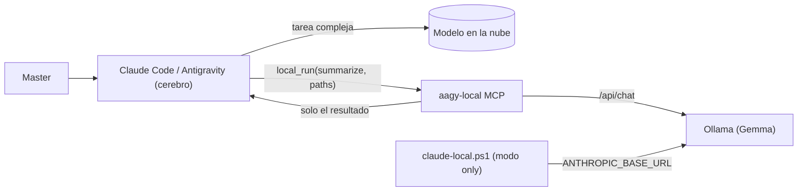

# Fase 1: Toma de Requisitos — Modelo local con Ollama (`aagy` / `aagy-ecc`)

> **Referencia de Gobernanza**: Fase 1 del Workflow de Ingeniería AAGY / Home-Lab
> **ID de Tarea**: `feat/aagy/local-model`
> **Fecha**: `2026-11-24` | **Autor/Rol**: `Claude (toma de requisitos) / Master (aprobación)`
> **Estado**: `BORRADOR` (P-01, P-04, P-05, P-06, P-07, P-12 y P-13 resueltas; resto de la §9 pendiente)
> **Ubicación en el repo**: `doc/06-backlog/plans/REQ_aagy_local_model.md`

---

## 0. Estado actual (hallazgos en `main` @ `59cda4b`)

| Pieza | Dónde | Qué hace hoy | Relevancia para este requisito |
| :--- | :--- | :--- | :--- |
| Enrutado de modelo | `aagy-ecc/commands/model-route.md` | Recomienda `haiku` / `sonnet` / `opus` según complejidad y presupuesto | No conoce ningún modelo local. Es el sitio natural para añadir el nivel `local`. |
| Interruptor de MCP | `scripts/py/toggle_gemini_mcp.py` | Activa o desactiva `gemini-mcp` en `mcp_config.json` con `"disabled": true/false` | Patrón ya probado para encender o apagar un servidor MCP sin coste de tokens en reposo. Se puede reutilizar. |
| Plantilla MCP | `skills/gemini-deep-ops/templates/gemini-mcp/mcp_config.json` | Servidor `gemini-mcp` por `npx` | Ejemplo de registro MCP en el lado Antigravity. |
| Doctor | `scripts/py/doctor_core.py` (DOC-01..DOC-15) | Catálogo común a `aagy-doctor` y `aagy-ecc-doctor` | Falta un check del modelo local (sería DOC-16). |
| Hooks `aagy-ecc` | `aagy-ecc/hooks/hooks.json` | SessionStart inyecta reglas, PreToolUse safety + guarda de worktree | Sirven para avisar del modo activo y para la guarda de ficheros privados (RF-09). |
| Referencias a Ollama/Gemma | Ninguna en código | Gemma solo aparece en `google-modern-stack.md` | Todo es nuevo. |

**Conclusión**: el harness no tiene hoy ninguna vía hacia un modelo local. Ya hay piezas reutilizables (interruptor MCP, doctor, hooks, `/model-route`).

---

## 1. Contexto, Necesidad y Objetivos

- **Problema**: todas las tareas, incluso las triviales (resumir un log, clasificar un fichero, generar un mensaje de commit) o las que tocan datos privados, van al modelo en la nube. Eso gasta presupuesto de contexto y saca datos del equipo.
- **Objetivo principal**: que el harness pueda (a) **delegar** tareas ligeras o privadas en un modelo local (Ollama + Gemma) manteniendo a Claude/Gemini como cerebro, y (b) **funcionar solo** con el modelo local cuando se pida (sin red, sin cuota, o por privacidad total). Ambos modos se encienden y apagan de forma explícita y comprobable.
- **Alcance (`In-Scope`)**:
  - Modo **herramienta**: servidor MCP propio que llama a Ollama, registrado en ambos harnesses.
  - Modo **sustituto**: lanzar Claude Code contra Ollama (`ANTHROPIC_BASE_URL`), con un lanzador del harness.
  - Interruptores: variables de entorno, script determinista, comando `/aagy-local`, check del doctor.
  - Reglas de delegación (qué va al modelo local y qué no) y guarda de ficheros privados.
  - Paridad simétrica `aagy` ↔ `aagy-ecc`.
- **Fuera de Alcance (`Out-of-Scope`)**:
  - Instalar Ollama, drivers de GPU o descargar modelos automáticamente (el doctor lo indica, no lo hace; ver P-08).
  - Afinar (*fine-tuning*) modelos.
  - Servir el modelo a otros equipos de la red (home-lab) como servicio compartido (posible fase 2, P-10).

---

## 2. Opciones evaluadas

| Opción | Cómo funciona | A favor | En contra |
| :--- | :--- | :--- | :--- |
| **A. Sustituto** | Ollama habla la API de Anthropic. Con `ANTHROPIC_BASE_URL=http://localhost:11434`, `ANTHROPIC_AUTH_TOKEN=ollama`, `ANTHROPIC_API_KEY=""` y `--model <modelo>`, Claude Code entero (agente, subagentes, hooks) corre sobre el modelo local. | Cero datos fuera del equipo. Sin cuota. Sin código nuevo en el harness salvo el lanzador. Funciona sin red. | Gemma 12B se queda corto en modo agente: pierde el hilo en tareas largas y falla al llamar herramientas. El prompt del sistema de Claude Code + `rules/AGENTS.md` + skills ocupa mucho contexto, y Ollama por defecto da un contexto corto (hay que subir `OLLAMA_CONTEXT_LENGTH` a 32k–64k, que pide mucha VRAM). La URL es global: o todo va a Ollama o nada. Sin equivalente directo en Antigravity (ver P-06). |
| **B. Herramienta (recomendada)** | Servidor MCP genérico `aagy-local` (Python stdlib, stdio) con `local_status` y `local_run(task, …)`, y las tareas declaradas como datos (RF-02). Llama a `http://localhost:11434/api/chat`. Claude (o Gemini en Antigravity) decide cuándo delegar. | Claude sigue siendo el cerebro: calidad de agente intacta. Ahorra contexto y cuota en tareas baratas. El mismo servidor sirve a los dos harnesses (paridad natural). Gemma 12B basta para tareas acotadas de una sola llamada. Si Ollama no está, el harness sigue funcionando. | La privacidad solo es real si el contenido privado **no pasa** por Claude: el servidor debe leer los ficheros por ruta y devolver solo el resultado (RF-03, RF-09). Claude puede olvidarse de delegar: hacen falta reglas y, si se quiere, un hook que lo empuje. Añade un servidor que mantener. |
| **C. Proxy enrutador** | Un proxy local (p. ej. LiteLLM) en `ANTHROPIC_BASE_URL` que manda unas peticiones a Anthropic y otras a Ollama según el modelo pedido (p. ej. el alias `haiku` → Gemma). | Enrutado automático sin que Claude decida. | Dependencia externa pesada (va contra RNF-03). Claude Code usa el modelo pequeño para tareas internas que Gemma puede romper. Difícil de depurar. Solo como idea para más adelante. |

**Recomendación**: B como modo principal (`tool`), A como modo explícito y aislado (`only`), C descartada por ahora. Los dos modos comparten la configuración de Ollama, el doctor y el comando.

## 2.1 Modelos locales propuestos para FRACTAL (RTX 3080 Ti 12 GB, RAM al 83 %)

Datos de tamaño y contexto de guías publicadas en octubre–noviembre de 2026. Las cifras de benchmark las da cada fabricante y nadie las ha reproducido. Hay que medirlas en FRACTAL antes de fijarlas (RF-15).

| Papel | Modelo (etiqueta Ollama) | Tamaño aprox. | Por qué | Modo |
| :--- | :--- | :--- | :--- | :--- |
| **Tareas sencillas** (clasificar, resumir, extraer, traducir, autocompletar texto) | `gemma4:12b` (Q4_K_M) | ~8 GB; ~9,4 GB a 64k de contexto | Sustituye a `gemma3:12b`: misma familia Gemma, llamada a funciones nativa, contexto de 256k. Cabe entero en la GPU. | `tool` |
| **Autocompletado en el editor** (FIM, Tab en VS Code / Zed / Continue) | `qwen2.5-coder:1.5b-base` | ~1 GB | Modelo `-base` pensado para *fill-in-the-middle*, muy rápido. Cabe a la vez que Gemma 4 sin expulsarlo de la VRAM. Licencia Apache 2.0. | Fuera del harness (P-12) |
| **Agente solo local** (Claude Code sobre Ollama) | `qwen3.5:9b` | ~6,5 GB; ~8,8 GB a 64k | Llama a herramientas y aguanta 64k en la GPU. Es el mejor equilibrio para 12 GB. | `only` |
| Excluidos del harness por decisión de Master | `bonsai-2:27b`; Gemma `e2b` / `e4b` | — | Master no quiere `bonsai-2:27b`. Los Gemma `e2b`/`e4b` se reservan para chats personales: el harness no los usa ni los comprueba. | — |
| Descartados en FRACTAL | `qwen3-coder:30b`, `devstral:24b`, `qwen3.6:35b`, `flint:40b` | 14–24 GB | No caben en 12 GB. Los MoE necesitan unos 32 GB de RAM libre y FRACTAL tiene el 83 % en uso. | — |
| Descartado | `qwen2.5-coder:14b` | ~9 GB | Es de 2024 y en la práctica solo llega a 10–20k de contexto en 12 GB. | — |

**Estrategia**:

1. **Un modelo por papel** (decidido por Master, 2026-11-24): familia Gemma (`gemma4:12b`) para `tool`, `qwen2.5-coder:1.5b-base` para el Tab del editor y `qwen3.5:9b` para `only`. Los nombres son solo valores por defecto en configuración; otro proyecto puede usar otros sin tocar el plugin.
2. **Lo que requiere pensar se queda en Claude/AGY** (decisión de la P-04). Ningún modelo local diseña, planifica, depura ni revisa código en el modo `tool`. El modo `only` es para cuando no hay nube, asumiendo calidad reducida.
3. **Convivencia en la VRAM**: Gemma 4 (~8–9 GB) y el FIM (~1 GB) pueden estar cargados a la vez. El modelo de `only` sustituye a Gemma mientras dura esa sesión. Ollama descarga y carga solo (unos segundos), así que `OLLAMA_MAX_LOADED_MODELS=2` basta.
4. **Medir antes de fijar**: `local_model.py bench` pasa un conjunto pequeño de tareas del repo (clasificar 20 ficheros, resumir 5 logs, extraer 10 JSON, traducir 5 párrafos) a cada candidato. Guarda la precisión y los tokens/s en `.governance/local-model-bench.json` (datos generados, no configuración), y el doctor avisa si el modelo configurado no se ha medido.

## 2.2 Ecosistema propuesto: dos suscripciones + modelo local

Editores en uso, confirmados por Master el 2026-11-24: **VS Code y Antigravity**. No se contemplan otros.

Cada suscripción solo se puede usar desde su herramienta oficial: Claude desde Claude Code y la de Google desde Antigravity/Gemini. Una extensión de terceros (Continue, Cline…) necesitaría claves de API de pago aparte. Por eso no se unifica con una única herramienta, sino con **una capa común, que es `aagy`**, encima de los tres motores:

| Capa | Antigravity (editor agy) | VS Code | Qué aporta |
| :--- | :--- | :--- | :--- |
| Agente con suscripción Google | Agente nativo de Antigravity (Gemini) | — | Cerebro Gemini, plugin `aagy` |
| Agente con suscripción Claude | Extensión Claude Code (Antigravity es un fork de VS Code; hay que comprobar que la extensión se instala desde Open VSX) | Extensión Claude Code + CLI | Cerebro Claude, plugin `aagy-ecc` |
| Autocompletado Tab local | Continue, solo con el rol `autocomplete` → Ollama `qwen2.5-coder:1.5b-base` | Igual | FIM gratis y privado. Una sola configuración en `~/.continue/config.yaml` que comparten los dos editores. |
| Tareas sencillas locales | MCP `aagy-local` → `gemma4:12b` | MCP `aagy-local` → `gemma4:12b` | Mismo servidor para los dos agentes |
| Común | Reglas, skills, backlog compartido, worktrees por agente, doctor | Igual | Paridad `aagy` ↔ `aagy-ecc` |

Notas: el Tab de Copilot no admite modelos locales, así que en los dos editores se desactiva el autocompletado nativo para que no choque con Continue. Continue se usa solo para el Tab y no como chat, para no pagar API.

---

## 3. Modos y cómo se activan

| Modo | Valor de `AAGY_LOCAL_MODEL` | Qué pasa | Cómo se activa | Cómo se desactiva |
| :--- | :--- | :--- | :--- | :--- |
| Automático | `auto` (por defecto, P-13) | Al arrancar, el harness comprueba en menos de 1 s si Ollama responde en `AAGY_OLLAMA_URL` y si está el modelo de `tool`. Si está, se comporta como `tool`. Si no, como `off`, sin avisos ni coste de tokens. | Nada: basta con tener Ollama y el modelo. | `AAGY_LOCAL_MODEL=off` o `/aagy-local off`. |
| Apagado | `off` | Nada cambia respecto a hoy. El servidor MCP no expone herramientas. | — | — |
| Herramienta | `tool` | Como `auto`, pero forzado: si Ollama no responde, DOC-16 da FAIL y el SessionStart avisa. | `/aagy-local on` (o `local-model.ps1 on`). | `/aagy-local off` o volver a `auto`. Si Ollama cae, las llamadas devuelven un error claro y Claude sigue solo. |
| Solo local | `only` | Claude Code arranca contra Ollama. El SessionStart avisa en grande de que no hay modelo en la nube. | Lanzador `scripts/ps1/claude-local.ps1` (+ `.sh`): fija las variables **solo para ese proceso** y ejecuta `claude --model <modelo>`. | Cerrar esa sesión. Una sesión normal de `claude` nunca hereda el modo (P-03). |

Variables propuestas (todas con prefijo `AAGY_`, leídas por script, servidor y doctor):

| Variable | Por defecto | Uso |
| :--- | :--- | :--- |
| `AAGY_LOCAL_MODEL` | `auto` | `auto` / `off` / `tool` / `only` |
| `AAGY_OLLAMA_URL` | `http://localhost:11434` | Dónde está Ollama (permite otro equipo del home-lab, P-10) |
| `AAGY_LOCAL_MODEL_NAME` | `gemma4:12b` | Modelo para el modo herramienta (§2.1) |
| `AAGY_LOCAL_AGENT_MODEL` | `qwen3.5:9b` | Modelo para el modo solo local, que necesita llamar herramientas (§2.1, P-05) |
| `AAGY_LOCAL_NUM_CTX` | `8192` | Contexto por llamada en modo `tool` (en FRACTAL, 8k mantiene Gemma 12B entero en la GPU) |
| `AAGY_LOCAL_TIMEOUT_S` | `120` | Tiempo máximo por llamada |

La configuración persistente se lee con `aagy_config` (#104, PR #99), sin fichero propio: los modelos y la URL de Ollama van en la clave `local_model` de la capa de entorno (`<AAGY_ENV_DIR>/aagy/env.json`), y lo propio del proyecto (globs privados, tareas delegables) en `local_model` de `.governance/aagy.json`. El plugin no trae nombres de modelo fijos: los de la tabla son los valores de FRACTAL. Las variables de entorno mandan sobre los ficheros.

---

## 4. Requisitos Funcionales (RF)

| ID | Requisito | Prioridad |
| :--- | :--- | :--- |
| RF-01 | Servidor MCP **genérico** `scripts/py/local_model_mcp.py` (stdio, solo stdlib de Python) que habla con la API nativa de Ollama (`/api/chat`, `/api/tags`). Espejado a `aagy-ecc`. Sin dependencias duras: si no hay Ollama, el plugin se instala y funciona igual en cualquier proyecto (P-13). | Must |
| RF-02 | **Sin herramientas ad hoc** (P-13). El servidor expone solo dos herramientas genéricas: `local_status` y `local_run(task, text \| paths)`. Las tareas son datos, no código: un catálogo declarativo (nombre, instrucción, modelo, esquema de salida, tamaño máximo) con los valores por defecto del plugin (`classify`, `summarize`, `extract`, `translate`, `complete`, según la P-04). Cada proyecto puede ampliarlo o recortarlo en `local_model.tasks` de `.governance/aagy.json` sin tocar el plugin. No hay tarea de pregunta libre. | Must |
| RF-03 | `local_run` acepta `text` **o** `paths`. Con `paths`, el servidor lee los ficheros él mismo, así el contenido no entra en el contexto de Claude. | Must |
| RF-04 | La respuesta lleva siempre `model`, `duration_ms` y `truncated`. Si Ollama no responde, devuelve un error estructurado (no excepción) para que Claude siga sin él. | Must |
| RF-05 | Registro del servidor en ambos harnesses: `aagy-ecc` lo declara en el plugin (`mcpServers` / `.mcp.json`); `aagy` en `mcp_config.json` de Antigravity. Con el modo `off`, o en `auto` sin Ollama, el servidor responde a `tools/list` con una lista vacía: cero tokens. | Must |
| RF-06 | Script determinista `scripts/py/local_model.py` (+ wrappers ps1/sh) con `on`, `off`, `auto`, `status`, `only` (lanza la sesión local). Idempotente. | Must |
| RF-07 | Comando `/aagy-local on/off/status` en Claude Code y workflow/skill equivalente en Antigravity. | Must |
| RF-08 | Regla en `rules/AGENTS.md` (pocas líneas, por presupuesto de contexto): al modelo local van **solo** tareas sencillas y repetitivas (clasificar, resumir, extraer datos, traducir, autocompletar). Todo lo que requiera pensar (diseño, planificación, depuración, revisión, cambios de código, decisiones) se queda en Claude/AGY. Lo privado va siempre por `paths`. | Must |
| RF-09 | Guarda de privacidad (PreToolUse), **avisar y preguntar** (P-07): si una ruta casa con `local_model.private_globs` de `.governance/aagy.json`, el hook no bloquea. Avisa de que el fichero es privado, propone `local_run` con `paths` y pide confirmación a Master antes de que Claude lo lea (en Claude Code, decisión `ask` del hook). Si el modelo local no está disponible, el aviso lo dice. En Antigravity, el equivalente que permita su sistema de hooks; si no admite preguntar, se documenta la asimetría. | Should |
| RF-10 | `/model-route` añade el nivel `local` para las tareas del catálogo, solo si el modo efectivo es `tool` (forzado o por `auto`). | Should |
| RF-11 | Modo `only`: el lanzador fija `ANTHROPIC_BASE_URL`, `ANTHROPIC_AUTH_TOKEN`, `ANTHROPIC_API_KEY=""`, `AAGY_LOCAL_MODEL=only` y avisa si el contexto de Ollama es menor de 32k. El SessionStart detecta el modo y lo anuncia. | Must |
| RF-12 | Modo `only`: el SessionStart inyecta una versión reducida de las reglas (Tier 1 mínimo) para dejar contexto al modelo pequeño (P-09). | Should |
| RF-13 | Doctor DOC-16 "Modelo local" en `doctor_core.py`: SKIP si `off`, o si es `auto` y no hay Ollama. En otro caso comprueba que Ollama responde, que los modelos configurados están descargados, el tamaño de contexto, que el servidor está registrado y que el modo cuadra con la config. `--fix` solo propone `ollama pull <modelo>`. | Must |
| RF-14 | Registro mínimo de uso: cada llamada local añade una línea (herramienta, modelo, duración, bytes) a un log local, sin contenido, para medir el ahorro. | Could |
| RF-15 | `local_model.py bench`: mide cada modelo candidato con tareas reales del repo (precisión y tokens/s) y guarda el resultado. DOC-16 avisa si el modelo configurado no se ha medido. | Should |
| RF-16 | Modo `only` en Antigravity: lanzador `scripts/ps1/agy-local.ps1` (+ `.sh`) que ejecuta un agente del SDK de Antigravity (`google-antigravity`, ≥ 0.1.18) con `LocalOpenAIAgentConfig` contra Ollama (`AAGY_OLLAMA_URL`, modelo `AAGY_LOCAL_AGENT_MODEL` = `qwen3.5:9b`), cargando las reglas reducidas de `aagy`. El SDK es una dependencia **blanda**: si no está instalado, el lanzador lo indica con el comando `pip install`, DOC-16 da WARN y el resto del plugin no cambia. El editor de Antigravity sigue con `auto`/`tool`. | Must |

## 5. Requisitos No Funcionales (RNF)

| ID | Requisito |
| :--- | :--- |
| RNF-01 | Sin dependencias duras: con o sin Ollama, el plugin se instala igual en cualquier proyecto. Si no hay modelo local, el comportamiento y el coste de tokens son los de hoy. |
| RNF-02 | Degradación limpia: con Ollama caído o lento, el harness sigue funcionando con el modelo en la nube (modo `tool`). |
| RNF-03 | Windows primero (FRACTAL, PowerShell), compatible con Linux/macOS. Solo stdlib de Python + Ollama. Sin LiteLLM ni SDKs. |
| RNF-04 | Paridad simétrica: un solo servidor y un solo script en la raíz, espejados a `aagy-ecc` por `sync_aagy_ecc.py`; `audit_plugin_parity.py` lo comprueba. |
| RNF-05 | Privacidad: nada de lo leído por `paths` se escribe en logs ni se devuelve completo; solo el resultado. |
| RNF-06 | Tests en `scripts/py/tests/test_local_model.py` con un Ollama simulado (servidor HTTP falso en local): status, cada herramienta, Ollama caído, timeout, guarda privada. |
| RNF-07 | Markdown y mensajes en español. |

---

## 6. Flujo propuesto

---

## 7. Criterios de Aceptación (CA)

- **CA-01**: en un equipo sin Ollama (modo `auto`), el plugin se instala sin errores, DOC-16 da SKIP y la sesión no muestra herramientas `local_*`. Con `AAGY_LOCAL_MODEL=off` pasa lo mismo aunque haya Ollama.
- **CA-02**: en FRACTAL con Ollama y `gemma4:12b`, sin configurar nada (`auto`), `local_status` responde y DOC-16 da PASS.
- **CA-03**: Claude llama a `local_run(task="summarize", paths=[log])`; la transcripción muestra el resumen pero no el contenido del log.
- **CA-04**: con Ollama parado, `local_run` devuelve un error estructurado y Claude completa la tarea por sí mismo.
- **CA-05**: con `secrets/**` en `private_globs`, un `Read` de `secrets/a.txt` muestra un aviso que propone `local_run` y pregunta antes de leer. Si Master acepta, Claude lo lee; si no, no.
- **CA-06**: `claude-local.ps1` abre una sesión que responde con el modelo local; cerrar esa ventana y abrir `claude` normal vuelve a la nube sin tocar nada.
- **CA-07**: la misma prueba CA-02/CA-03 funciona desde Antigravity con el mismo servidor.

---

## 8. Riesgos

| Riesgo | Mitigación |
| :--- | :--- |
| Gemma 12B no llama bien a herramientas en modo `only` | Modelo de agente separado (`AAGY_LOCAL_AGENT_MODEL`, P-05) y aviso claro de calidad reducida. |
| Falsa sensación de privacidad: Claude lee el fichero y luego "delega" | Contenido privado solo por `paths` (RF-03) + guarda RF-09. |
| Contexto corto de Ollama trunca el prompt sin avisar | DOC-16 y el lanzador comprueban el contexto; las herramientas marcan `truncated`. |
| VRAM insuficiente en FRACTAL para 12B con 32k+ de contexto | Pregunta P-01; modelo más pequeño para `tool`. |
| Quedarse en modo `only` sin darse cuenta | Variables solo en el proceso del lanzador; aviso en SessionStart. |
| Las definiciones de las herramientas MCP gastan contexto | Lista corta (RF-02) y servidor deshabilitado en modo `off`. |

---

## 9. Preguntas abiertas para Master

| ID | Pregunta | Propuesta por defecto |
| :--- | :--- | :--- |
| P-01 | ¿Qué GPU y cuánta VRAM tiene FRACTAL? | **Respondida (Master, 2026-11-24)**: RTX 3080 Ti 12 GB, 32 GB de RAM (83 % en uso), Ryzen 9 5950X. Se descarta un modelo que dependa de la RAM. `gemma4:12b` (~8 GB) cabe en la GPU y llega a unos 64k de contexto. La elección por papel está en la §2.1. Ollama 0.40.18 ya instalado: incluye la API compatible con Anthropic que necesita el modo `only` y la API nativa (`/api/chat`) del modo `tool`. |
| P-02 | ¿Prioridad: ahorro de cuota, privacidad o trabajar sin red? | Privacidad y ahorro (modo `tool` primero); `only` como segunda entrega. |
| P-03 | Modo `only`: ¿solo por lanzador (proceso aislado) o también persistente en `settings.json`? | Solo lanzador, para no quedarse en local sin querer. |
| P-04 | ¿Qué tareas delegar? | **Decidido (Master, 2026-11-24)**: solo tareas sencillas y repetitivas: clasificar, resumir, extraer datos, traducir y autocompletar. Todo lo que requiera pensar se queda en Claude/AGY. |
| P-05 | Modelo para el modo `only` | **Decidido (Master, 2026-11-24)**: `qwen3.5:9b`. `bonsai-2:27b` descartado. |
| P-06 | Modo `only` en Antigravity | **Decidido (Master, 2026-11-24): SDK de Antigravity en esta entrega.** (1) **Editor/agente de Antigravity**: no admite Ollama ni otro endpoint propio como modelo principal; los ID de modelo propios se rechazan y vuelve a Gemini (issue #212 del SDK; guía de agentpedia, julio de 2026). Sí puede usar Ollama como herramienta por MCP, así que el modo `tool` funciona igual. (2) **SDK de Antigravity** (`google-antigravity` para Python, desde la 0.1.18, septiembre de 2026): admite modelos locales con `LocalOpenAIAgentConfig` (Ollama, LM Studio, vLLM) o LiteRT. Es un agente programático fuera del editor. (3) **Parche no oficial** `antigravity-add-model`: modifica la app instalada y maneja credenciales OAuth; no soporta el IDE basado en VS Code y se rompe con las actualizaciones. Descartado. **Propuesta**: Antigravity solo con `auto`/`tool`. Un modo `only` opcional con el SDK (`agy-local` lanzado desde terminal, dependencia blanda: si no está el paquete, DOC-16 lo indica) entra en esta entrega (RF-16). Fuentes: [blog de Google](https://developers.googleblog.com/introducing-support-for-local-ai-models-in-the-antigravity-sdk/), [issue #212](https://github.com/google-antigravity/antigravity-sdk-python/issues/212), [agentpedia](https://agentpedia.codes/blog/antigravity-local-models-ollama-setup), [antigravity-add-model](https://github.com/vahapogut/antigravity-add-model). **Resultado**: editor con `auto`/`tool`. Modo `only`: lanzador `agy-local` con el SDK (RF-16). |
| P-07 | Guarda de ficheros privados | **Decidido (Master, 2026-11-24)**: avisar y preguntar, no bloquear. Rutas privadas por defecto: `.env*` y `secrets/**`, ampliables por proyecto. |
| P-08 | ¿El doctor solo avisa o `--fix` puede ejecutar `ollama pull`? | Solo propone el comando. |
| P-09 | Modo `only`: ¿reglas reducidas en el SessionStart para dejar contexto, aunque pierda guardarraíles de texto (los hooks siguen activos)? | Sí, reducidas. |
| P-10 | ¿Ollama siempre en FRACTAL, o también en otro equipo del home-lab (`AAGY_OLLAMA_URL` remoto)? | Solo local en esta entrega; la variable ya lo deja preparado. |
| P-11 | ¿Que Claude delegue por su cuenta (solo reglas), o un hook que le recuerde delegar cuando detecte tareas típicas (p. ej. leer un log grande)? | Solo reglas al principio; medir con RF-14 y decidir. |
| P-12 | Autocompletado Tab en el editor (FIM) | **Decidido (Master, 2026-11-24)**: `qwen2.5-coder:1.5b-base`, integrado en Antigravity y en VS Code. Propuesta: Continue, solo como autocompletado (§2.2). Entra como guía + plantilla de `config.yaml` + check en DOC-16, sin código propio. |
| P-13 | Principios del plugin | **Decidido (Master, 2026-11-24)**: el plugin nunca implementa herramientas ad hoc. Se instala desde cualquier proyecto sin dependencias duras. Viene preparado para usar modelos locales cuando el equipo los tiene, salvo que se desactive (`auto` por defecto). En nuestro caso, los modelos se usan solo para las tareas de la P-04. Además, el harness debe poder trabajar solo con modelos locales (modo `only`). |
