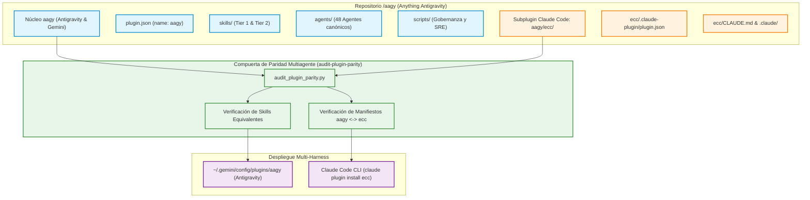

# Fase 2: Plan de Acción, Diseño Arquitectónico y Estrategia TDD | Migración /ecc a /aagy

> **Referencia de Requisitos**: [`doc/plan/REQ_aagy_clean_docs_and_repo_migration.md`](REQ_aagy_clean_docs_and_repo_migration.md)  
> **ID de Tarea**: `chore/aagy/repo-migration-cutover` (`Tarea 5.1`)  
> **Fecha**: 2026-11-20 | **Estado**: `LISTO PARA EJECUCIÓN`  

---

## 1. Inventario de Reutilización y Prevención de Duplicados (DRY First)

- **Módulos y Componentes Reutilizados**:
  - `plugin.json`: Manifiesto canónico de Antigravity (renombrado de `ecc-agy` a `aagy`).
  - `ecc-claude/`: Consolidado en `ecc/` para representar fielmente el plugin hermano para Claude Code.
  - `scripts/ecc-agy/format_commit.py`: Extendido para incluir `aagy` en `ALLOWED_PROJECTS`.
  - `scripts/ecc-agy/sonar_audit.py` y `security_audit.py`: Exclusión de `ecc/` (código externo de Claude Code).
  - `scripts/bin/ecc-agy/complete-task-pr.ps1` y `.sh`: Paso 7.6 de validación de paridad de plugins.
- **Validación de Dependencias**:
  - Uso estricto de APIs nativas de Python 3 y PowerShell 7. Cero dependencias externas.

---

## 2. Topología Arquitectónica y Flujo de Cutover



---

## 3. Estrategia de Implementación TDD (RED -> GREEN -> REFACTOR)

1. **Fase RED (Test Primero)**:
   - Crear `scripts/ecc-agy/tests/test_audit_plugin_parity.py`.
   - Definir pruebas para:
     - Detección de paridad estructural (directorio `ecc/` y `plugin.json`).
     - Validación de nombres de plugin (`aagy` en raíz y `ecc` en subplugin).
     - Validación de CLI (`--check-only`, `--json`, `--help`).
     - Códigos de salida apropiados (`0` en paridad, `1` en divergencia).
   - Ejecutar pruebas y verificar fallo inicial (`RED`).

2. **Fase GREEN (Implementación)**:
   - Consolidar `ecc-claude/` en `ecc/` vía `git mv`.
   - Actualizar `package.json` raíz (`"workspaces": ["ecc"]`).
   - Actualizar `plugin.json` raíz a `name: "aagy"`.
   - Implementar `scripts/ecc-agy/audit_plugin_parity.py`.
   - Crear wrappers `scripts/bin/ecc-agy/audit-plugin-parity.ps1` y `audit-plugin-parity.sh`.
   - Ejecutar pruebas y verificar que pasen (`GREEN`).

3. **Fase REFACTOR (Calidad y Guardrails)**:
   - Validar SonarQube Rating A (Cognitive Complexity $\le 15$, 0 duplicados `S1192`).
   - Integrar `audit-plugin-parity.ps1` en el pipeline de `complete-task-pr.ps1` y `complete-task-pr.sh`.
   - Formatear con `lint-markdown.ps1 -Fix`.

---

## 4. Costes Arquitectónicos Ocultos y Plan de Rollback

- **Costes Visibles**:
  - Renombrado de repositorio en GitHub (`gh repo rename aagy`).
  - Ruta de plugin en `~/.gemini/config/plugins/aagy`.
- **Costes Ocultos**:
  - Enlaces o atajos preexistentes que referencien `ecc-agy`.
  - **Mitigación**: Mantener alias y retrocompatibilidad en `install.ps1` y enlazado symlink en `~/.gemini/config/plugins/ecc-agy` si es requerido.
- **Plan de Rollback Inmediato ($< 2$ minutos)**:
  - En caso de anomalía:

    ```bash
    git revert <squash-commit-sha>
    gh repo rename ecc --yes
    ```
