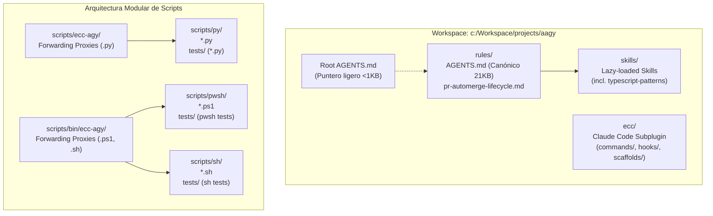

# Fase 2: Plan de Acción, Diseño de Arquitectura y TDD

> **Referencia de Gobernanza**: Fase 2 del Workflow de Ingeniería ECC / Home-Lab  
> **ID de Tarea**: `refactor/aagy/token-opt-and-scripts-reorg` (`Tarea 0.1`)  
> **Fecha**: `2026-11-20` | **Autor/Rol**: `Principal Agentic Runtime & Token Budget Optimizer`  
> **Estado**: `APROBADO`

---

## 1. Inventario de Activos a Reutilizar (DRY First)

- **Reglas Principales**: `rules/AGENTS.md` (fuente canónica del plugin) y `rules/pr-automerge-lifecycle.md`.
- **Skills Existentes**: `angular-developer`, `golang-patterns`, `golang-testing`, `java-coding-standards`, `springboot-patterns`, `python-patterns`, `python-testing`, `frontend-patterns`.
- **Scripts Existentes**:
  - `scripts/ecc-agy/*.py` $\rightarrow$ trasladados a `scripts/py/`.
  - `scripts/bin/ecc-agy/*.ps1` $\rightarrow$ trasladados a `scripts/pwsh/`.
  - `scripts/bin/ecc-agy/*.sh` $\rightarrow$ trasladados a `scripts/sh/`.
- **Dependencias**: Solo librerías estándar de Python, PowerShell 7 y POSIX sh. Cero dependencias externas.

---

## 2. Topología Arquitectónica

---

## 3. Plan de Acción Secuencial y TDD (RED -> GREEN -> REFACTOR)

### Paso 1: Poda y Migración de Reglas (RED -> GREEN)

1. Crear `skills/typescript-patterns/SKILL.md` consolidando `rules/typescript/*.md` con frontmatter $\le 140$ caracteres.
2. Trasladar `pr-automerge-lifecycle.md` a `rules/pr-automerge-lifecycle.md`.
3. Purgar las subcarpetas `rules/{angular,golang,java,python,typescript,web,common}`.
4. Reducir `AGENTS.md` en la raíz a un puntero conciso manteniendo los marcadores de context caching y actualizando `test_static_prompt_caching_prefix_invariance` si es necesario.
5. Purgar `commands/` en la raíz de `aagy`, verificando que `ecc/commands/` permanece intacto.

### Paso 2: Reestructuración de Scripts (RED -> GREEN)

1. Crear estructura `scripts/py/`, `scripts/pwsh/`, `scripts/sh/`.
2. Mover archivos Python de `scripts/ecc-agy/*.py` y `scripts/ecc-agy/tests/` a `scripts/py/` y `scripts/py/tests/`.
3. Mover archivos `.ps1` de `scripts/bin/ecc-agy/` a `scripts/pwsh/`.
4. Mover archivos `.sh` de `scripts/bin/ecc-agy/` a `scripts/sh/`.
5. Crear proxies de retrocompatibilidad en `scripts/bin/ecc-agy/` y `scripts/ecc-agy/`.
6. Añadir tests unitarios para scripts pwsh y sh en `scripts/pwsh/tests/` y `scripts/sh/tests/`.

### Paso 3: Actualización de Invocaciones y Enlaces (REFACTOR)

1. Actualizar `hooks.json` para apuntar a `scripts/pwsh/safety-check.ps1` y `scripts/pwsh/hook-post-write.ps1`.
2. Actualizar `complete-task-pr.ps1`, `complete-task-pr.sh`, `ecc-agy-sync.ps1`, `ecc-agy-sync.sh` e `install.ps1`.
3. Actualizar `workspace_audit.py`, `audit_plugin_parity.py` y `sonar_audit.py`.

### Paso 4: Verificación Integral (VERIFY)

1. Ejecutar `python -m pytest scripts/py/tests -q`.
2. Ejecutar `audit-workspace.ps1` y `sonar-audit.ps1`.
3. Ejecutar `lint-markdown.ps1` con `--fix` en todos los archivos Markdown modificados.

---

## 4. Análisis de Costes de Arquitectura

| Decisión | Coste Visible | Coste Oculto (Ahorro / Beneficio) |
| :--- | :--- | :--- |
| **D1: Puntero ligero en root `AGENTS.md`** | Cambio menor en el archivo raíz. | Ahorro de ~5.500 tokens por turno al evitar carga duplicada en Antigravity. |
| **D2: Reglas de stack a `skills/` lazy-loaded** | Reorganización de 37 archivos en `skills/`. | Reducción de ~25.000 tokens potenciales siempre activos a coste 0 en reposo. |
| **D3: Reestructuración `scripts/{py,pwsh,sh}`** | Mover scripts y crear proxies de retrocompatibilidad. | Alta mantenibilidad, pruebas aisladas por runtime y cero scripts huérfanos. |
| **D4: Purga de `commands/` en la raíz** | Retirada de 97 archivos legacy. | Claridad arquitectónica: `ecc/` mantiene Claude Code y la raíz mantiene Antigravity. |

---

## 5. Plan de Rollback Inmediato (< 2 Minutos)

- **Comando**: `git checkout main && git branch -D refactor/aagy/token-opt-and-scripts-reorg`.
