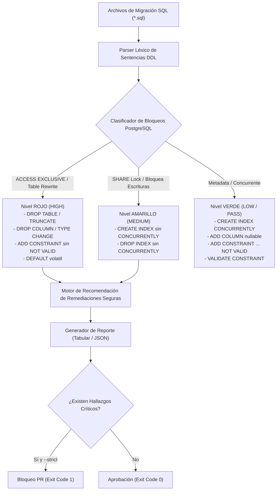

# Fase 2: Plan de Acción, Diseño Arquitectónico y Estrategia TDD | Analizador de Bloqueos DDL

> **Referencia de Requisitos**: [`doc/plan/REQ_ecc_audit_pg_locks.md`](REQ_ecc_audit_pg_locks.md)  
> **ID de Tarea**: `feat/ecc/audit-pg-locks`  
> **Fecha**: 2026-11-20 | **Estado**: `LISTO PARA EJECUCIÓN`  

---

## 1. Inventario de Reutilización y Prevención de Duplicados (DRY First)

- **Módulos Reutilizados**:
  - `pathlib.Path`: Gestión multiplataforma de rutas SQL.
  - `re`: Expresiones regulares precompiladas para extracción y clasificación de sentencias DDL.
  - `dataclasses`: Estructuras inmutables `@dataclass(frozen=True)` para hallazgos y clasificaciones.
  - `complete-task-pr.ps1`: Punto de enganche condicional ante archivos `.sql` modificados.
- **Validación de Dependencias**:
  - Uso estricto de Python standard library (`re`, `json`, `argparse`, `sys`, `pathlib`). Cero dependencias no oficiales.

---

## 2. Diseño Arquitectónico y Catálogo de Bloqueos DDL

---

## 3. Catálogo Detallado de Bloqueos y Reglas de Remediación

| Sentencia Detectada | Nivel de Riesgo | Bloqueo Adquirido | Impacto en Home-Lab | Alternativa Segura Recomendada |
| :--- | :---: | :---: | :--- | :--- |
| `CREATE INDEX ...` (sin `CONCURRENTLY`) | `MEDIUM` | `SHARE` | Bloquea INSERT/UPDATE/DELETE durante la creación del índice. | Usar `CREATE INDEX CONCURRENTLY ...` fuera de bloques de transacción. |
| `DROP INDEX ...` (sin `CONCURRENTLY`) | `MEDIUM` | `ACCESS EXCLUSIVE` breve | Bloquea consultas concurrentes. | Usar `DROP INDEX CONCURRENTLY ...`. |
| `ALTER TABLE ... ADD CONSTRAINT ... FOREIGN KEY / CHECK` (sin `NOT VALID`) | `HIGH` | `ACCESS EXCLUSIVE` | Escanea toda la tabla bajo bloqueo exclusivo verificando filas existentes. | Añadir la constraint con `NOT VALID` (bloqueo instantáneo) y validar luego con `VALIDATE CONSTRAINT`. |
| `ALTER TABLE ... DROP COLUMN ...` | `HIGH` | `ACCESS EXCLUSIVE` | Bloquea todas las operaciones. | Deprecar primero en la aplicación y eliminar en una ventana de mantenimiento planificada. |
| `ALTER TABLE ... ALTER COLUMN ... TYPE ...` | `HIGH` | `ACCESS EXCLUSIVE` | Provoca reescritura de tabla (*table rewrite*) completa. | Crear una nueva columna, sincronizar vía dual-write o triggers, y migrar gradualmente. |
| `DROP TABLE / TRUNCATE` | `HIGH` | `ACCESS EXCLUSIVE` | Bloqueo absoluto y destrucción de datos. | Verificar si requiere archivado previo o renombrado temporal. |
| `ALTER TABLE ... ADD COLUMN ... DEFAULT <volatil>` | `HIGH` | `ACCESS EXCLUSIVE` | En funciones volátiles (`now()`, `random()`), reescribe cada tupla. | Añadir columna sin default, poblar en lotes pequeños, y asignar default para nuevas filas. |

---

## 4. Plan de Acción Paso a Paso (TDD: RED -> GREEN -> REFACTOR)

### 4.1. Fase 1: Tests Primero (`RED`)

- Crear `scripts/ecc-agy/tests/test_audit_pg_locks.py` con fixtures cubriendo:
  1. `test_skip_when_no_sql_files`: Salida limpia `SKIPPED` cuando no hay archivos `.sql`.
  2. `test_detect_dangerous_create_index`: Detección de `CREATE INDEX` sin concurrencia con riesgo `MEDIUM`.
  3. `test_detect_safe_create_index_concurrently`: Aprobación de `CREATE INDEX CONCURRENTLY`.
  4. `test_detect_unvalidated_foreign_key`: Detección de `ADD CONSTRAINT` sin `NOT VALID` con riesgo `HIGH`.
  5. `test_detect_safe_constraint_with_not_valid`: Aprobación de `ADD CONSTRAINT ... NOT VALID`.
  6. `test_detect_table_rewrite_operations`: Detección de `ALTER COLUMN TYPE` y `DROP COLUMN`.
  7. `test_json_output_format`: Verificación de estructura JSON de salida.

### 4.2. Fase 2: Implementación Mínima Segura (`GREEN`)

- Desarrollar `scripts/ecc-agy/audit_pg_locks.py`:
  - Regex precompiladas para extracción y clasificación léxica.
  - Complejidad cognitiva $\le 12$ por función (`S3776`).
  - Constantes para evitar duplicados de cadenas (`S1192`).
- Desarrollar wrappers CLI `scripts/bin/ecc-agy/audit-pg-locks.ps1` y `audit-pg-locks.sh`.
- Integrar en `complete-task-pr.ps1` y `complete-task-pr.sh` para escaneo de archivos `.sql` modificados.

### 4.3. Fase 3: Refactorización y Clean Code (`REFACTOR`)

- Comprobar 100% de tests pasando en pytest.
- Ejecutar `sonar-audit.ps1` (Rating A).
- Formatear con `lint-markdown.ps1 -Fix`.

---

## 5. Plan de Rollback Inmediato (< 2 minutos)

Reversión atómica mediante `git revert <sha>` del commit o invocación de `audit-pg-locks.ps1 -NoStrict` para emitir alertas sin bloquear el merge.
