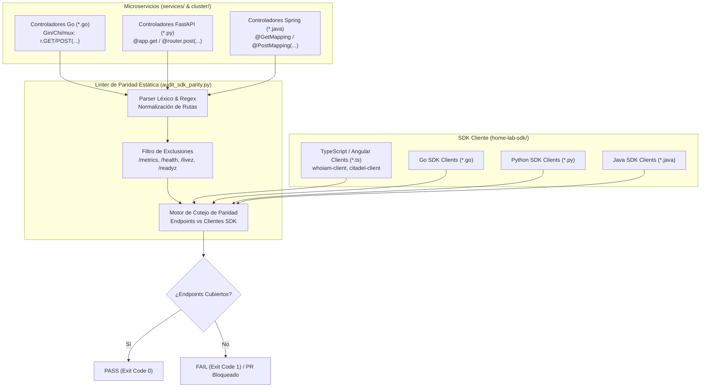

# Fase 2: Plan de Acción, Diseño Arquitectónico y Estrategia TDD | Linter de Paridad SDK

> **Referencia de Requisitos**: [`doc/plan/REQ_ecc_audit_sdk_parity.md`](REQ_ecc_audit_sdk_parity.md)  
> **ID de Tarea**: `feat/ecc/audit-sdk-parity`  
> **Fecha**: 2026-11-20 | **Estado**: `LISTO PARA EJECUCIÓN`  

---

## 1. Inventario de Reutilización y Prevención de Duplicados (DRY First)

- **Módulos y Servicios Reutilizados**:
  - `pathlib.Path`: Manipulación de rutas multiplataforma.
  - `re`: Expresiones regulares optimizadas y precompiladas para extracción de controladores Go, Python y Java.
  - `typing.NamedTuple` / `@dataclass(frozen=True)`: Estructuras inmutables para endpoints y clientes.
  - `scripts/bin/ecc-agy/complete-task-pr.ps1`: Punto de enganche en la fase de Quality Gate previa al commit y PR.
- **Validación de Dependencias**:
  - Uso estricto de la biblioteca estándar de Python (`re`, `json`, `argparse`, `sys`, `pathlib`).
  - Cero dependencias no autorizadas de terceros.

---

## 2. Diseño Arquitectónico y Topología de Extracción

---

## 3. Estrategia de Paridad y Sincronización `home-lab-sdk`

La herramienta que se desarrolla en esta tarea es precisamente el **motor automatizado de verificación** de la paridad de `home-lab-sdk`.

- **Endpoints Internos Excluidos**:
  - `^/(metrics|health|healthz|livez|readyz|ping|status|debug(/.*)?|favicon\.ico)$`
- **Normalización de Parámetros**:
  - Parámetros de ruta en Go (`:id`, `*param`), FastAPI (`{id}`), o Spring (`{id}`) se normalizan a `{param}` para coincidencia unívoca con los métodos cliente.

---

## 4. Plan de Acción Paso a Paso (TDD: RED -> GREEN -> REFACTOR)

### 4.1. Fase 1: Tests Primero (`RED`)

- Crear `scripts/ecc-agy/tests/test_audit_sdk_parity.py` con fixtures para:
  1. `test_skip_when_no_services_or_sdk_dir`: Verificación de salida limpia (código `0`, `SKIPPED`) en repositorios sin microservicios.
  2. `test_parity_pass_when_all_endpoints_covered`: Microservicios Go/Py/Java con clientes correspondientes en TS/Go/Py.
  3. `test_parity_fail_when_endpoint_missing_in_sdk`: Detección precisa de endpoint huérfano con código `1`.
  4. `test_excluded_endpoints_ignored`: Rutas `/metrics`, `/health`, `/livez` no requieren cliente SDK.
  5. `test_json_output_contract`: Validación del esquema JSON devuelto por `--json`.
  6. `test_cli_diff_mode`: Verificación de escaneo selectivo.

### 4.2. Fase 2: Implementación Mínima Segura (`GREEN`)

- Desarrollar `scripts/ecc-agy/audit_sdk_parity.py`:
  - Funciones puras con tipado estricto y docstrings.
  - Complejidad cognitiva $\le 10$ por función (`S3776`).
  - Constantes inmutables para evitar duplicados de cadenas (`S1192`).
- Desarrollar wrappers:
  - `scripts/bin/ecc-agy/audit-sdk-parity.ps1`
  - `scripts/bin/ecc-agy/audit-sdk-parity.sh`
- Integrar en `scripts/bin/ecc-agy/complete-task-pr.ps1` (bloque de verificación previa).

### 4.3. Fase 3: Refactorización y Clean Code (`REFACTOR`)

- Ejecutar `pytest scripts/ecc-agy/tests/test_audit_sdk_parity.py`.
- Ejecutar `sonar-audit.ps1` verificando 0 violaciones y Rating A.
- Ejecutar `lint-markdown.ps1 -Fix` sobre los documentos generados.

---

## 5. Plan de Rollback Inmediato (< 2 minutos)

Si la integración generara falsos positivos en repositorios sin microservicios:

- Revertir el commit único con `git revert <sha>` o ejecutar `audit-sdk-parity.ps1` con flag `--no-strict` mientras se ajusta la heurística.
