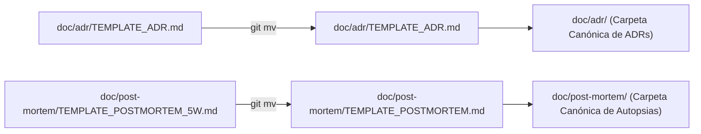

# Fase 2: Plan de Acción Detallado, TDD y Arquitectura

> **Referencia de Gobernanza**: Fase 2 del Workflow de Ingeniería ECC / Home-Lab  
> **ID de Tarea**: `refactor/ecc/doc-templates-standardization`  
> **Fecha**: `2026-11-20` | **Autor/Rol**: `Carbon (C6) / Documentation Governance Architect`  
> **Estado**: `APROBADO`  

---

## 1. Inventario DRY de Activos Existentes

| Activo Reutilizable | Tipo (`Clase / Script / DTO / Función`) | Ubicación Relativa | Estrategia de Reutilización (`Extender / Importar / Componer`) |
| :--- | :--- | :--- | :--- |
| `TEMPLATE_REQUISITOS_ARQUITECTURA.md` | Markdown Template | `doc/adr/TEMPLATE_ADR.md` | Mover con `git mv` a `doc/adr/TEMPLATE_ADR.md`. |
| `TEMPLATE_POSTMORTEM_5W.md` | Markdown Template | `doc/post-mortem/TEMPLATE_POSTMORTEM_5W.md` | Renombrar con `git mv` a `doc/post-mortem/TEMPLATE_POSTMORTEM.md`. |
| `generate_postmortem.py` | Python Script | `scripts/ecc-agy/generate_postmortem.py` | Actualizar constante `DEFAULT_TEMPLATE`. |

---

## 2. Diagrama de Reubicación de Plantillas

---

## 3. Plan de Implementación TDD (`RED` -> `GREEN` -> `REFACTOR`)

### 3.1. Fase RED (Test Primero)

- Modificar `test_generate_postmortem.py` para asegurar que el path por defecto esperado sea `doc/post-mortem/TEMPLATE_POSTMORTEM.md`.

### 3.2. Fase GREEN (Implementación)

- Ejecutar `git mv doc/adr/TEMPLATE_ADR.md doc/adr/TEMPLATE_ADR.md`.
- Ejecutar `git mv doc/post-mortem/TEMPLATE_POSTMORTEM_5W.md doc/post-mortem/TEMPLATE_POSTMORTEM.md`.
- Actualizar `generate_postmortem.py` y `generate-postmortem.ps1` / `.sh`.
- Reemplazar referencias textuales en `README.md`, `doc/INDEX.md`, `doc/README.md`, etc.
- Pasar los tests unitarios.

### 3.3. Fase REFACTOR & VERIFY

- Validar con `lint-markdown.ps1` todos los archivos modificados.
- Ejecutar `audit-workspace.ps1`.
