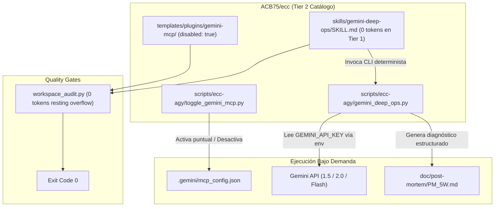

# Fase 2: Plan de Acción, Diseño Arquitectónico y Estrategia TDD

> **Referencia de Requisitos**: [`doc/plan/REQ_ecc_gemini_mcp_deep_ops.md`](REQ_ecc_gemini_mcp_deep_ops.md)  
> **ID de Tarea**: `feat/ecc/gemini-mcp-deep-ops`  
> **Fecha**: `2026-11-20` | **Estado**: `LISTO PARA EJECUCIÓN`  

---

## 1. Inventario de Reutilización y Prevención de Duplicados (DRY First)

- **Módulos Reutilizados**:
  - [`scripts/ecc-agy/workspace_audit.py`](file:///c:/Workspace/projects/ecc/scripts/ecc-agy/workspace_audit.py): Validación de presupuesto para la plantilla del plugin y verificación de la longitud de descripción de la nueva skill.
  - [`scripts/bin/ecc-agy/generate-postmortem.ps1`](file:///c:/Workspace/projects/ecc/scripts/bin/ecc-agy/generate-postmortem.ps1): Punto de integración para análisis multimodal de incidencias.
- **Validación de Dependencias**:
  - Python standard library (`json`, `os`, `sys`, `pathlib`, `argparse`, `dataclasses`). Paquetes oficiales para llamadas opcionales a Gemini (`urllib.request` nativo o SDK oficial si está disponible). Cero librerías no aprobadas.

---

## 2. Diseño Arquitectónico y Topología

---

## 3. Plan de Acción Paso a Paso (TDD: RED -> GREEN -> REFACTOR)

### 3.1. Fase 1: Tests Primero (`RED`)

- [x] Crear `scripts/ecc-agy/tests/test_gemini_deep_ops.py`:
  - `test_toggle_gemini_mcp_status_and_toggle()`: Comprueba alternancia segura de `"disabled": true` / `false` sin corromper el JSON.
  - `test_gemini_deep_ops_cli_status()`: Valida comando `status` con y sin `GEMINI_API_KEY`.
  - `test_gemini_deep_ops_analyze_log_mock()`: Valida análisis de logs simulado con salida estructurada JSON y Markdown.
  - `test_template_gemini_mcp_config_disabled()`: Verifica que el manifiesto de la plantilla contenga `"disabled": true`.

### 3.2. Fase 2: Implementación Mínima Segura (`GREEN`)

- [x] Crear `templates/plugins/gemini-mcp/`:
  - `plugin.json` (`"disabled": true`).
  - `mcp_config.json` (`"gemini-mcp"` con `"disabled": true` y `"GEMINI_API_KEY": "${GEMINI_API_KEY}"`).
  - `README.md` con instrucciones de activación puntual.
- [x] Implementar `scripts/ecc-agy/toggle_gemini_mcp.py` y wrappers en `scripts/bin/ecc-agy/`.
- [x] Implementar `scripts/ecc-agy/gemini_deep_ops.py` y wrappers en `scripts/bin/ecc-agy/`.
- [x] Crear `skills/gemini-deep-ops/SKILL.md` con descripción $\le 140$ caracteres.
- [x] Crear `doc/manual/MANUAL_gemini_deep_ops_multimodal.md`.

### 3.3. Fase 3: Refactorización y Clean Code (`REFACTOR`)

- [x] Enforzar SonarQube Quality Gate Rating A (Cognitive Complexity $\le 15$, cero duplicaciones).
- [x] Pasar markdownlint DavidAnson en todos los `.md`.

### 3.4. Fase 4: Bucle de Verificación Pre-Merge (`VERIFY`)

- [x] `pytest scripts/ecc-agy/tests/` (100% verde).
- [x] `audit-workspace.ps1` exit code 0.

---

## 4. Análisis de Costes de la Decisión Arquitectónica

| Decisión Técnica Adoptada | Alternativa Descartada | Coste Visible | Coste Oculto (Mitigado) |
| :--- | :--- | :--- | :--- |
| **Plantilla Aislada con `disabled: true`** | Habilitar `gemini-mcp` en el plugin global | Cero tokens en reposo | Requiere comando puntual si se desea activar en sesión interactiva |
| **Skill Tier 2 con CLI nativo** | Inyectar 30 tools MCP en el system prompt | Ejecución controlada vía subproceso | Ahorro masivo de contexto (>4.500 tokens por turno) |

---

## 5. Mitigación de Riesgos y Plan de Fast-Rollback (< 2 Minutos)

- **Riesgo**: Que un desarrollador cometa accidentalmente `GEMINI_API_KEY` en `mcp_config.json`.
  - **Mitigación**: La plantilla usa exclusivamente `${GEMINI_API_KEY}` y la auditoría de seguridad (`security_audit.py`) bloquea cualquier commit con tokens hardcodeados.
- **Estrategia de Rollback**: `git revert HEAD` en $< 2$ minutos.
