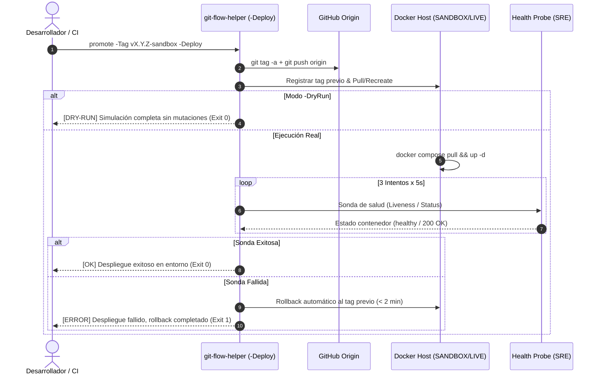

# Fase 2: Plan de Acción, Diseño Arquitectónico y Estrategia TDD | Despliegue Tagged en git-flow-helper

> **Referencia de Requisitos**: [`doc/plan/REQ_ecc_git_flow_deploy.md`](REQ_ecc_git_flow_deploy.md)  
> **ID de Tarea**: `feat/ecc/git-flow-deploy`  
> **Fecha**: 2026-11-20 | **Estado**: `LISTO PARA EJECUCIÓN`  

---

## 1. Inventario de Reutilización y Prevención de Duplicados (DRY First)

- **Módulos Reutilizados**:
  - `scripts/bin/ecc-agy/git-flow-helper.ps1`: Base canónica de orquestación Git Trunk-Based.
  - `scripts/bin/ecc-agy/git-flow-helper.sh`: Implementación dual POSIX sh.
  - `docker compose`: Comandos estándar de la industria (`pull`, `up -d`, `ps`, `logs`).
- **Validación de Dependencias**:
  - Uso estricto de APIs nativas de PowerShell 7 (`Set-StrictMode`, `Start-Sleep`, `Invoke-RestMethod` o `docker compose ps`). Cero módulos externos no autorizados.

---

## 2. Diseño Arquitectónico y Diagrama de Secuencia del Despliegue

---

## 3. Parámetros de Entorno y Configuración de Hosts

| Entorno (`-Environment`) | Host por Defecto | Variable de Override | Comando de Despliegue |
| :--- | :--- | :--- | :--- |
| `sandbox` | FRACTAL (`192.168.1.100`) | `$env:HOMELAB_SANDBOX_HOST` | `docker compose -f docker-compose.yml up -d` |
| `live` | NEO (`192.168.1.200`) | `$env:HOMELAB_LIVE_HOST` | `docker compose -f docker-compose.yml up -d` |

---

## 4. Plan de Acción Paso a Paso (TDD: RED -> GREEN -> REFACTOR)

### 4.1. Fase 1: Tests Primero (`RED`)

- Crear `scripts/ecc-agy/tests/test_git_flow_deploy.py` con fixtures cubriendo:
  1. `test_dry_run_sandbox_promotion`: Comprobar que `-Action promote -Tag v1.0.0-sandbox -Deploy -DryRun` emita los pasos correctos sin error.
  2. `test_dry_run_live_promotion`: Comprobar que `-Action promote -Tag v1.0.0 -Deploy -Environment live -DryRun` emita el host correcto.
  3. `test_deploy_without_tag_throws`: Comprobar que omitir `-Tag` genere excepción explicativa.
  4. `test_health_probe_logic`: Simular verificación de sondas y lógica de reintentos.
  5. `test_rollback_logic_triggered_on_failure`: Simular fallo en sonda y ejecución de rollback.

### 4.2. Fase 2: Implementación Mínima Segura (`GREEN`)

- Extender `scripts/bin/ecc-agy/git-flow-helper.ps1`:
  - Nuevos parámetros: `[switch]$Deploy`, `[ValidateSet("sandbox", "live")][string]$Environment = "sandbox"`, `[switch]$DryRun`.
  - Función interna `Invoke-Deployment`: secuencia de backup, despliegue, sondas y rollback.
- Extender `scripts/bin/ecc-agy/git-flow-helper.sh`:
  - Soporte de banderas `--deploy`, `--env [sandbox|live]`, `--dry-run`.

### 4.3. Fase 3: Refactorización y Clean Code (`REFACTOR`)

- Comprobar suite pytest pasando al 100%.
- Ejecutar `sonar-audit.ps1` (Rating A).
- Formatear con `lint-markdown.ps1 -Fix`.

---

## 5. Plan de Rollback Inmediato (< 2 minutos)

Si el despliegue automático experimentara fallos en caliente:

- Ejecutar: `pwsh -File scripts/bin/ecc-agy/git-flow-helper.ps1 -Action promote -Tag <tag-anterior> -Deploy`
- O restaurar con `git checkout <tag-anterior> && docker compose up -d`.
