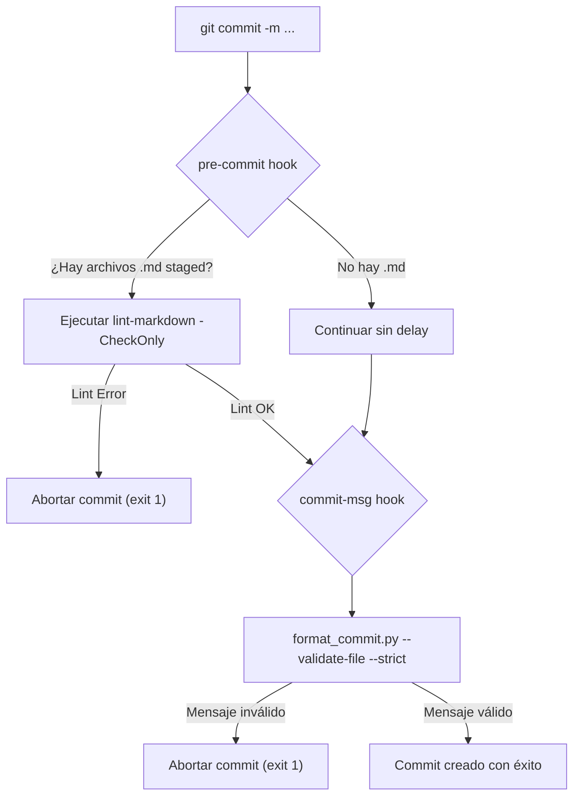

# Fase 2: Plan de Acción Detallado, TDD y Arquitectura

> **Referencia de Gobernanza**: Fase 2 del Workflow de Ingeniería ECC / Home-Lab  
> **ID de Tarea**: `feat/ecc/git-pre-commit-hooks`  
> **Fecha**: `2026-11-20` | **Autor/Rol**: `Carbon (C6) / Git Operations Specialist`  
> **Estado**: `APROBADO`  

---

## 1. Inventario DRY de Activos Existentes

| Activo Reutilizable | Tipo (`Clase / Script / DTO / Función`) | Ubicación Relativa | Estrategia de Reutilización (`Extender / Importar / Componer`) |
| :--- | :--- | :--- | :--- |
| `format_commit.py` | Python Script | `scripts/ecc-agy/format_commit.py` | Invocado por `commit-msg` con `--validate-file <path> --strict`. |
| `lint-markdown.ps1` | PowerShell Script | `scripts/bin/ecc-agy/lint-markdown.ps1` | Invocado por `pre-commit` para validar archivos `.md` staged. |
| `lint-markdown.sh` | Bash Script | `scripts/bin/ecc-agy/lint-markdown.sh` | Invocado por `pre-commit` en entornos Linux. |

---

## 2. Diagrama de Flujo de Ejecución de Hooks Git

---

## 3. Plan de Implementación TDD (`RED` -> `GREEN` -> `REFACTOR`)

### 3.1. Fase RED (Test Primero)

- Crear `scripts/ecc-agy/tests/test_git_hooks.py`.
- Simular ejecución de `commit-msg` con mensaje válido e inválido.
- Simular instalación con `install_git_hooks`.
- Ejecutar pytest y verificar fallo inicial antes de crear los ejecutables.

### 3.2. Fase GREEN (Implementación)

- Crear `scripts/ecc-agy/hooks/pre-commit` (POSIX sh).
- Crear `scripts/ecc-agy/hooks/commit-msg` (POSIX sh).
- Crear `scripts/bin/ecc-agy/install-git-hooks.ps1` y `install-git-hooks.sh`.
- Pasar los tests.

### 3.3. Fase REFACTOR & VERIFY

- Añadir permisos y verificar ejecución en Windows 11 (`pwsh`).
- Comprobar linting con `lint-markdown.ps1`.
- Ejecutar `audit-workspace.ps1`.
