# Fase 2: Plan de Acción, Diseño Arquitectónico y Estrategia TDD

> **Referencia de Requisitos**: [`doc/plan/REQ_ecc_hooks_agentshield_instincts.md`](REQ_ecc_hooks_agentshield_instincts.md)  
> **ID de Tarea**: `feat/ecc/hooks-agentshield-instincts`  
> **Fecha**: `2026-11-20` | **Estado**: `LISTO PARA EJECUCIÓN`  

---

## 1. Inventario de Reutilización y Prevención de Duplicados (DRY First)

- **Módulos Reutilizados**:
  - [`scripts/ecc-agy/security_audit.py`](file:///c:/Workspace/projects/ecc/scripts/ecc-agy/security_audit.py): Extensión in-place incorporando los detectores *AgentShield*.
  - [`scripts/bin/ecc-agy/lint-markdown.ps1`](file:///c:/Workspace/projects/ecc/scripts/bin/ecc-agy/lint-markdown.ps1): Invocado condicionalmente por el hook `PostToolUse`.
- **Validación de Dependencias**:
  - Exclusivamente Python standard library (`json`, `re`, `argparse`, `dataclasses`, `pathlib`).

---

## 2. Topología Arquitectónica

```mermaid
flowchart TD
    subgraph AntigravityEngine["Antigravity Runtime Loop"]
        PreTool["PreToolUse (run_command)"] --> SafetyHook["hooks.json -> safety-check.ps1"]
        SafetyHook -- "Safe" --> ExecTool["Tool Execution"]
        SafetyHook -- "Destructive" --> Block["Abort Execution"]
        ExecTool --> PostTool["PostToolUse (write_file / edit_file)"]
        PostTool --> LintHook["hooks.json -> hook-post-write.ps1"]
        LintHook --> AutoFormat["lint-markdown.ps1 -Fix"]
    end

    subgraph AgentShield["Auditoría de Seguridad (AgentShield)"]
        SecurityAudit["security_audit.py"] --> ScanHooks["scan_agentshield_hooks()"]
        SecurityAudit --> ScanSkills["scan_agentshield_skills()"]
        SecurityAudit --> ScanMCP["scan_agentshield_mcp()"]
    end

    subgraph Instincts["Instintos por Proyecto"]
        Manager["instinct_manager.py"] --> Storage[".agents/instincts/*.md"]
        Storage --> ProgressiveContext["Carga selectiva sin inflar AGENTS.md"]
    end
```

---

## 3. Plan de Acción Paso a Paso (TDD: RED -> GREEN -> REFACTOR)

### 3.1. Fase 1: Tests Primero (`RED`)

- [x] Crear `scripts/ecc-agy/tests/test_agentshield_instincts.py`:
  - `test_agentshield_hooks_scanner()`: Detecta `eval` o timeouts excesivos en `hooks.json`.
  - `test_agentshield_skills_prompt_injection()`: Detecta intentos de bypass de seguridad.
  - `test_agentshield_mcp_plaintext_secrets()`: Detecta claves en texto plano en `mcp_config.json`.
  - `test_instinct_manager_save_and_list()`: Valida creación y lectura de instintos en `.agents/instincts/`.

### 3.2. Fase 2: Implementación Mínima Segura (`GREEN`)

- [x] Crear `hooks.json` en la raíz con configuración para `run_command` y `write_file`/`edit_file`.
- [x] Implementar `scripts/bin/ecc-agy/hook-post-write.ps1` (`.sh`) y `safety-check.ps1` (`.sh`).
- [x] Extender `scripts/ecc-agy/security_audit.py` con las funciones AgentShield.
- [x] Implementar `scripts/ecc-agy/instinct_manager.py` y wrappers `manage-instincts.ps1` (`.sh`).

### 3.3. Fase 3: Refactorización y Clean Code (`REFACTOR`)

- [x] SonarQube Rating A (Cognitive Complexity $\le 15$, cero duplicaciones).
- [x] Formato DavidAnson en todos los archivos Markdown.

### 3.4. Fase 4: Bucle de Verificación Pre-Merge (`VERIFY`)

- [x] Suite `pytest` con todos los tests en verde.
- [x] `audit-workspace.ps1` exit code 0.

---

## 4. Análisis de Costes de la Decisión Arquitectónica

| Decisión Técnica Adoptada | Alternativa Descartada | Coste Visible | Coste Oculto (Mitigado) |
| :--- | :--- | :--- | :--- |
| **Hooks en `hooks.json` nativo** | Reglas en texto plano en `AGENTS.md` | Handlers locales en disco | Ahorro permanente de tokens en cada turno conversacional |
| **Instintos desacoplados en `.agents/instincts/`** | Añadir cada corrección a `AGENTS.md` | Archivos markdown modulares | Evita la degradación del context budget global |

---

## 5. Mitigación de Riesgos y Plan de Fast-Rollback (< 2 Minutos)

- **Riesgo**: Que un hook bloquee una edición legítima por timeout o fallo de shell.
  - **Mitigación**: Timeouts seguros (5s) y captura no bloqueante en scripts con salida informativa.
- **Estrategia de Rollback**: `git revert HEAD` en $< 2$ minutos.
