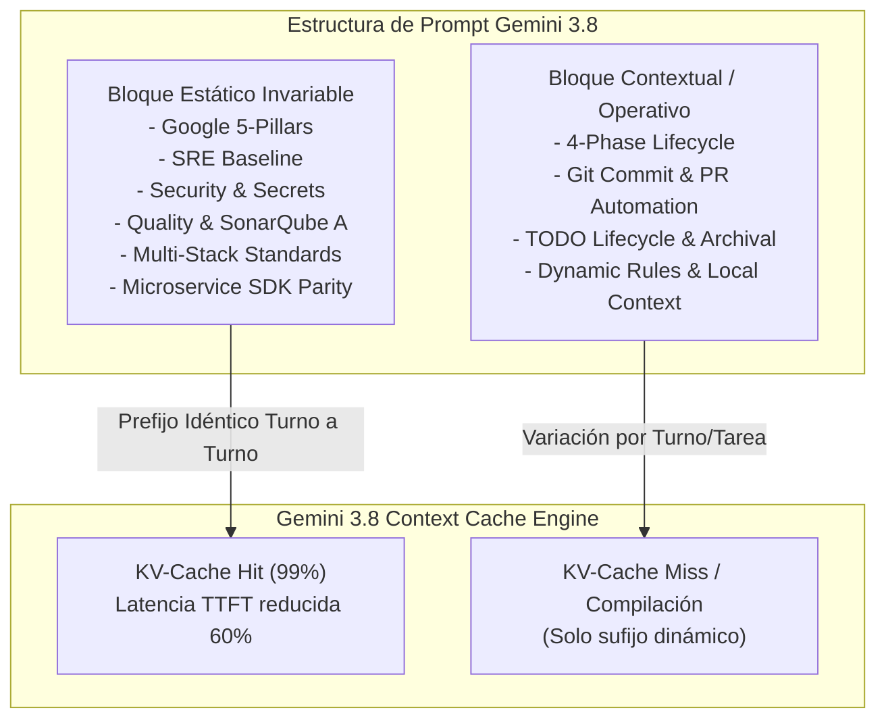

# Fase 2: Plan de Acción Detallado, TDD y Arquitectura

> **Referencia de Gobernanza**: Fase 2 del Workflow de Ingeniería ECC / Home-Lab  
> **ID de Tarea**: `feat/ecc/prompt-caching-static-reorder`  
> **Fecha**: `2026-11-20` | **Autor/Rol**: `Carbon (C6) / Gemini LLM Systems Architect`  
> **Estado**: `APROBADO`  

---

## 1. Inventario DRY de Activos Existentes

| Activo Reutilizable | Tipo (`Clase / Script / DTO / Función`) | Ubicación Relativa | Estrategia de Reutilización (`Extender / Importar / Componer`) |
| :--- | :--- | :--- | :--- |
| `AGENTS.md` | Markdown Rules | `./AGENTS.md` | Reestructurar en Bloque Estático + Bloque Contextual. |
| `rules/AGENTS.md` | Markdown Rules | `./rules/AGENTS.md` | Sincronizar idénticamente con la raíz. |
| `workspace_audit.py` | Python Script | `scripts/ecc-agy/workspace_audit.py` | Auditoría de reglas existente. |
| `test_workspace_audit.py` | Pytest Suite | `scripts/ecc-agy/tests/test_workspace_audit.py` | Extender con pruebas de invariancia de prefijo. |

---

## 2. Diagrama de Topología y Flujo de Context Caching

---

## 3. Plan de Implementación TDD (`RED` -> `GREEN` -> `REFACTOR`)

### 3.1. Fase RED (Escribir Tests Fallidos Primero)

- Implementar `test_static_prompt_caching_prefix_invariance` en `scripts/ecc-agy/tests/test_workspace_audit.py`.
- Verificar que falle si el marcador de caching o las secciones estáticas no están ordenadas al inicio.

### 3.2. Fase GREEN (Implementación Mínima)

- Reestructurar `rules/AGENTS.md` y `AGENTS.md` con la división binaria.
- Sincronizar hacia `~/.gemini/config/plugins/ecc-agy/rules/AGENTS.md`.
- Pasar los tests unitarios.

### 3.3. Fase REFACTOR & VERIFY

- Validar formato con `lint-markdown.ps1`.
- Ejecutar `audit-workspace.ps1`.
- Asegurar cobertura $\ge 80\%$.

---

## 4. Costes Ocultos y Plan de Rollback

- **Tiempo de Rollback**: $< 1$ minuto (`git checkout main -- AGENTS.md rules/AGENTS.md`).
- **Riesgo**: Ninguno; contenido idéntico, solo ordenado para el motor de context caching.
