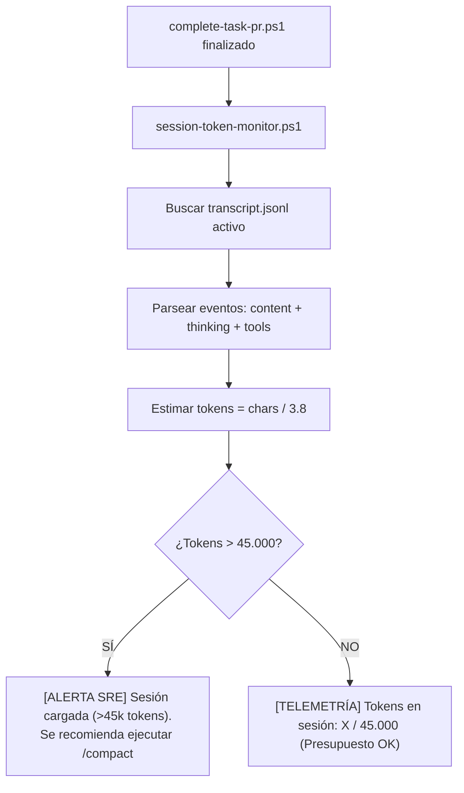

# Fase 2: Plan de Acción Detallado, TDD y Arquitectura

> **Referencia de Gobernanza**: Fase 2 del Workflow de Ingeniería ECC / Home-Lab  
> **ID de Tarea**: `feat/ecc/session-budget-telemetry`  
> **Fecha**: `2026-11-20` | **Autor/Rol**: `Carbon (C6) / SRE Token Optimization Specialist`  
> **Estado**: `APROBADO`  

---

## 1. Inventario DRY de Activos Existentes

| Activo Reutilizable | Tipo (`Clase / Script / DTO / Función`) | Ubicación Relativa | Estrategia de Reutilización (`Extender / Importar / Componer`) |
| :--- | :--- | :--- | :--- |
| `workspace_audit.py` | Constante `CHARS_PER_TOKEN` | `scripts/ecc-agy/workspace_audit.py` | Reutilizar ratio estándar de 3.8 chars por token. |
| `complete-task-pr.ps1` | PowerShell Script | `scripts/bin/ecc-agy/complete-task-pr.ps1` | Invocar telemetría al final del flujo. |

---

## 2. Diagrama de Flujo de Telemetría de Sesión

---

## 3. Plan de Implementación TDD (`RED` -> `GREEN` -> `REFACTOR`)

### 3.1. Fase RED (Test Primero)

- Crear `scripts/ecc-agy/tests/test_session_token_monitor.py`.
- Simular transcripts sintéticos con diferentes volúmenes y campos.
- Validar fallos iniciales en ausencia de `session_token_monitor.py`.

### 3.2. Fase GREEN (Implementación)

- Crear `scripts/ecc-agy/session_token_monitor.py`.
- Implementar wrappers `scripts/bin/ecc-agy/session-token-monitor.ps1` y `.sh`.
- Integrar en `complete-task-pr.ps1`.
- Pasar los tests unitarios.

### 3.3. Fase REFACTOR & VERIFY

- Probar en vivo con transcript real.
- Formatear con `lint-markdown.ps1`.
- Verificar compuerta de calidad SonarQube Rating A.
