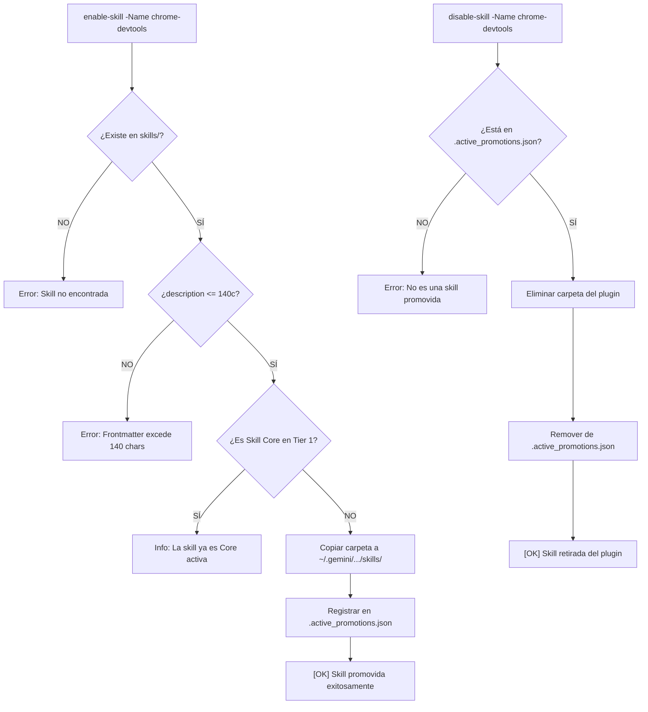

# Fase 2: Plan de Acción Detallado, TDD y Arquitectura

> **Referencia de Gobernanza**: Fase 2 del Workflow de Ingeniería ECC / Home-Lab  
> **ID de Tarea**: `feat/ecc/skill-promotion-cli`  
> **Fecha**: `2026-11-20` | **Autor/Rol**: `Carbon (C6) / Modular Plugin Architect`  
> **Estado**: `APROBADO`  

---

## 1. Inventario DRY de Activos Existentes

| Activo Reutilizable | Tipo (`Clase / Script / DTO / Función`) | Ubicación Relativa | Estrategia de Reutilización (`Extender / Importar / Componer`) |
| :--- | :--- | :--- | :--- |
| `read_frontmatter`, `frontmatter_field` | Funciones Parser | `scripts/ecc-agy/workspace_audit.py` | Reutilizar para validación estricta de `description` $\le 140$c. |
| `audit_skills` | Función Auditoría | `scripts/ecc-agy/workspace_audit.py` | Validación de presupuesto global de skills. |

---

## 2. Diagrama de Flujo de Promoción On-Demand

---

## 3. Plan de Implementación TDD (`RED` -> `GREEN` -> `REFACTOR`)

### 3.1. Fase RED (Test Primero)

- Crear `scripts/ecc-agy/tests/test_skill_promotion.py`.
- Simular directorios de origen y destino de plugin temporal.
- Comprobar fallos al importar funciones no existentes.

### 3.2. Fase GREEN (Implementación)

- Crear `scripts/ecc-agy/skill_promotion.py`.
- Implementar wrappers `enable-skill.ps1`, `enable-skill.sh`, `disable-skill.ps1`, `disable-skill.sh`.
- Pasar los tests unitarios.

### 3.3. Fase REFACTOR & VERIFY

- Validar protección de skills core y límite de frontmatter.
- Formatear con `lint-markdown.ps1`.
- Verificar compuerta de calidad SonarQube Rating A.
