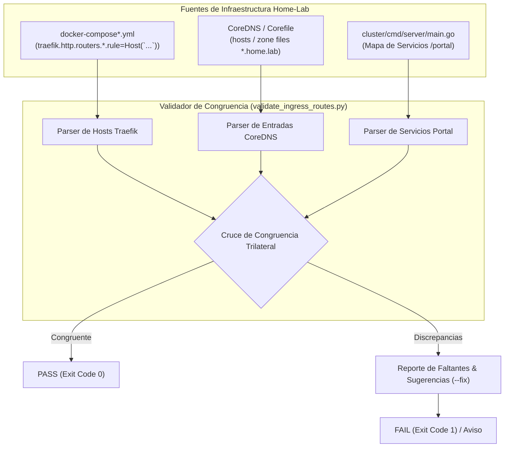

# Fase 2: Plan de Acción, Diseño Arquitectónico y Estrategia TDD | Validador Ingress / DNS / Portal

> **Referencia de Requisitos**: [`doc/plan/REQ_ecc_validate_ingress_routes.md`](REQ_ecc_validate_ingress_routes.md)  
> **ID de Tarea**: `feat/ecc/validate-ingress-routes`  
> **Fecha**: 2026-11-20 | **Estado**: `LISTO PARA EJECUCIÓN`  

---

## 1. Inventario de Reutilización y Prevención de Duplicados (DRY First)

- **Módulos Reutilizados**:
  - `pathlib.Path`: Búsqueda de `docker-compose*.yml`, `Corefile` y código Go de portal.
  - `re`: Expresiones regulares para parsing léxico de etiquetas Traefik, registros DNS de CoreDNS y catálogo de portal.
  - Python standard library pura (`re`, `json`, `argparse`, `sys`, `pathlib`). Cero dependencias externas.

---

## 2. Diseño Arquitectónico y Topología de Validación

---

## 3. Estrategia de Cruce y Detección de Discrepancias

1. **Hosts Traefik**:
   - Buscar etiquetas en `docker-compose*.yml` con patrón `Host\(`([^`]+)`\)`.
   - Excluir servicios con `traefik.enable=false`.
2. **Hosts CoreDNS**:
   - Buscar registros tipo `192.168.1.X\s+([a-zA-Z0-9_\-\.\s]+)` o bloques `hosts { ... }` en `Corefile` o archivos de zona.
3. **Servicios Portal**:
   - Extraer URLs y dominios registrados en el mapa `/portal` (ej. `https://<service>.home.lab` o cadenas con `.home.lab`).
4. **Validación Trilateral**:
   - `missing_in_dns`: Hosts Traefik que no están en CoreDNS.
   - `missing_in_portal`: Hosts Traefik que no están catalogados en `/portal`.

---

## 4. Plan de Acción Paso a Paso (TDD: RED -> GREEN -> REFACTOR)

### 4.1. Fase 1: Tests Primero (`RED`)

- Crear `scripts/ecc-agy/tests/test_validate_ingress_routes.py` con fixtures cubriendo:
  1. `test_skip_when_no_ingress_infrastructure`: Salida limpia `SKIPPED` cuando no hay archivos compose ni Corefile.
  2. `test_congruent_ingress_dns_portal_pass`: Congruencia total aprobada con `PASS`.
  3. `test_missing_dns_record_fail`: Detección precisa de host faltante en CoreDNS con `FAIL`.
  4. `test_missing_portal_entry_fail`: Detección precisa de host publicado ausente en el catálogo `/portal`.
  5. `test_fix_suggestions_generated`: Generación de snippets de remediación con `--fix`.
  6. `test_json_output_structure`: Estructura JSON válida con `--json`.

### 4.2. Fase 2: Implementación Mínima Segura (`GREEN`)

- Desarrollar `scripts/ecc-agy/validate_ingress_routes.py`:
  - Funciones puras con tipado estricto y docstrings.
  - Complejidad cognitiva $\le 12$ por función (`S3776`).
  - Constantes para evitar duplicados de cadenas (`S1192`).
- Desarrollar wrappers CLI `scripts/bin/ecc-agy/validate-ingress-routes.ps1` y `validate-ingress-routes.sh`.

### 4.3. Fase 3: Refactorización y Clean Code (`REFACTOR`)

- Comprobar tests pasando con pytest.
- Ejecutar `sonar-audit.ps1` (Rating A).
- Formatear con `lint-markdown.ps1 -Fix`.

---

## 5. Plan de Rollback Inmediato (< 2 minutos)

Reversión atómica mediante `git revert <sha>` del commit o ejecución en modo `-NoStrict` / `-AuditOnly`.
