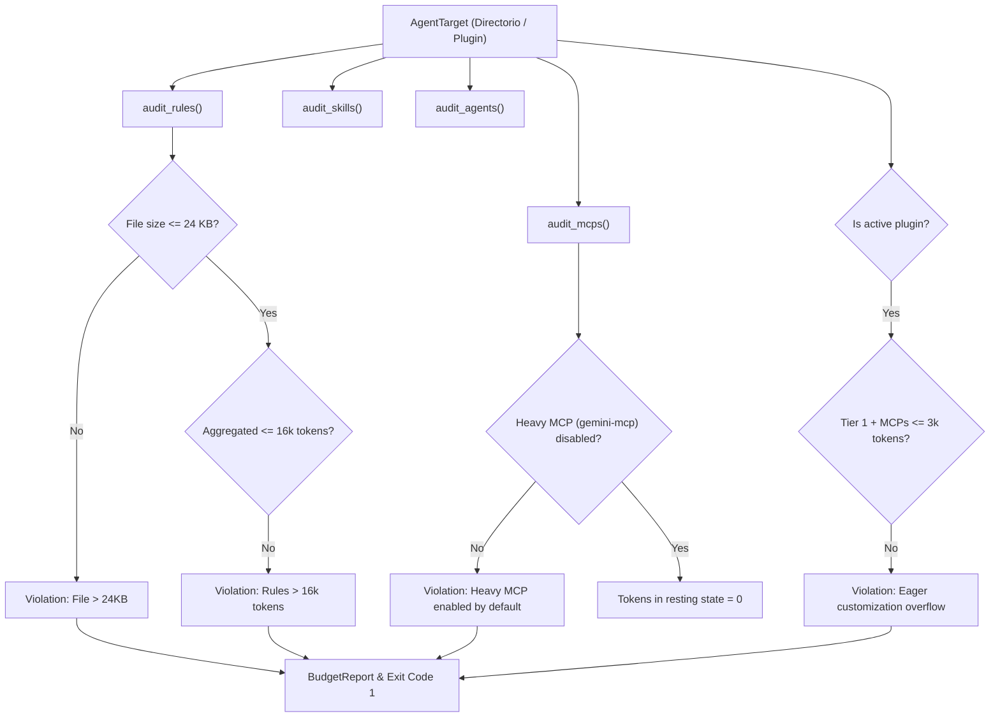

# Fase 2: Plan de Acción, Diseño Arquitectónico y Estrategia TDD

> **Referencia de Requisitos**: [`doc/plan/REQ_ecc_workspace_audit_budget_hard_gate.md`](REQ_ecc_workspace_audit_budget_hard_gate.md)  
> **ID de Tarea**: `feat/ecc/workspace-audit-budget-hard-gate`  
> **Fecha**: `2026-11-20` | **Estado**: `LISTO PARA EJECUCIÓN`  

---

## 1. Inventario de Reutilización y Prevención de Duplicados (DRY First)

- **Módulos y Servicios Reutilizados**:
  - [`scripts/ecc-agy/workspace_audit.py`](file:///c:/Workspace/projects/ecc/scripts/ecc-agy/workspace_audit.py): Extensión in-place conservando la arquitectura de análisis modular, logging y compuertas de higiene.
  - [`scripts/bin/ecc-agy/audit-workspace.ps1`](file:///c:/Workspace/projects/ecc/scripts/bin/ecc-agy/audit-workspace.ps1): Punto de entrada canónico en Windows PowerShell para invocar la auditoría.
- **Validación de Dependencias**:
  - Confirmación de uso exclusivo de Python standard library (`json`, `math`, `pathlib`, `logging`, `dataclasses`). Cero librerías externas de terceros.

---

## 2. Diseño Arquitectónico y Topología de Presupuesto

- **Inmutabilidad y Tipado**:
  - `BudgetReport` enriquecido con `rules_chars`, `rules_tokens`, `mcp_count`, `mcp_active_count`, `mcp_tokens`, y `violations: Tuple[str, ...]`.
  - `AgentTarget` enriquecido con `is_plugin: bool = False`.

---

## 3. Plan de Acción Paso a Paso (TDD: RED -> GREEN -> REFACTOR)

### 3.1. Fase 1: Tests Primero (`RED`)

- [x] Escribir casos de prueba en `scripts/ecc-agy/tests/test_workspace_audit.py` que fallen antes de la implementación:
  - `test_audit_rules_file_size_limit_and_budget()`: Verifica detección de archivo $> 24.000$ bytes y reglas agregadas $> 16.000$ tokens.
  - `test_audit_mcps_heavy_server_and_budget()`: Verifica detección de `gemini-mcp` habilitado por defecto y cálculo de tokens en reposo cuando está desactivado (`disabled: true`).
  - `test_audit_target_budget_eager_customization_overflow()`: Verifica que un plugin con exceso de personalizaciones eager supere el límite de 3.000 tokens y emita infracción.

### 3.2. Fase 2: Implementación Mínima Segura (`GREEN`)

- [x] Definir constantes de presupuesto en `scripts/ecc-agy/workspace_audit.py`:
  - `MAX_RULE_FILE_BYTES = 24_000`
  - `MAX_RULES_TOTAL_TOKENS = 16_000`
  - `MAX_EAGER_CUSTOMIZATION_TOKENS = 3_000`
  - `ACTIVE_MCP_BASE_TOKENS = 1_500`
  - `HEAVY_MCP_SERVERS = frozenset({"gemini-mcp"})`
  - `HEAVY_MCP_TOKENS = 4_500`
- [x] Implementar `audit_rules(target_dir, include_rules)`.
- [x] Implementar `audit_mcps(target_dir)`.
- [x] Integrar auditorías en `audit_target_budget(target)` y computar `estimated_tokens`.
- [x] Añadir detección del plugin global `~/.gemini/config/plugins/ecc-agy` en `main()`.

### 3.3. Fase 3: Refactorización y Clean Code (`REFACTOR`)

- [x] SonarQube Quality Gate: Complejidad Cognitiva $\le 15$ por función (`S3776`), $\le 7$ parámetros (`S107`), constantes para literales duplicados (`S1192`).
- [x] Ejecutar `pytest` y confirmar 100% de tests en verde.

### 3.4. Fase 4: Bucle de Verificación Pre-Merge (`VERIFY`)

- [x] Linter DavidAnson markdownlint con código 0.
- [x] Cobertura $\ge 80\%$ en pruebas de `workspace_audit.py`.
- [x] `audit-workspace.ps1` ejecutado con éxito.

---

## 4. Análisis de Costes de la Decisión Arquitectónica

| Decisión Técnica Adoptada | Alternativa Descartada | Coste Visible | Coste Oculto (Mitigado) |
| :--- | :--- | :--- | :--- |
| **Auditoría Estática Determinista stdlib** | Llamar CLI externo de inspección de MCPs | 0 ms latencia adicional en CI | Cero dependencias no oficiales; análisis instantáneo |
| **Cómputo en Reposo (0 tokens si disabled)** | Estimar siempre el coste de todos los MCPs | Precisión exacta del consumo real de contexto | Fomenta empaquetar plugins opcionales sin penalización |

---

## 5. Mitigación de Riesgos y Plan de Fast-Rollback (< 2 Minutos)

- **Riesgo**: Falso positivo en archivos markdown de documentación dentro de `rules/`.
  - **Mitigación**: Filtrar `README.md` y centrar la auditoría en archivos de reglas directos o subdirectorios de reglas.
- **Rollback Atómico**:
  - `git revert HEAD` en $< 2$ minutos en caso de degradación.
